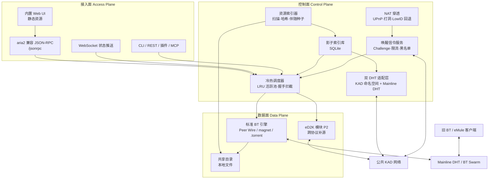

# 总体架构设计（ARCH）

> 编号 DOC-03 · 版本 2.0 · 状态 待评审 · 责任人 架构组 · 更新 2026-11-09
> 本文回答「**系统如何划分**」。模块内部实现见 [LLD](../03-design/LLD.md)，流程见 [FLOWS](../03-design/FLOWS.md)。

## 1. 控制面 / 数据面 / 接入面总览

**分离的意义**：控制面可以独立演进（换 DHT、加唤醒鉴权、调整索引策略），数据面始终保持 100% 标准协议，从而保证 [PRD P1/P2](../01-product/PRD.md) 的零协议侵入与向下兼容。

## 2. 分层架构

| 层 | 名称 | 职责 | 关键模块 |
| :--- | :--- | :--- | :--- |
| L0 | 基础设施 | 异步运行时、文件系统监控、加密哈希、配置、日志 | Tokio、notify、SQLite、tracing |
| L1 | 存储与索引 | 共享目录 → 指纹 → 伴随种子 → 影子索引 | Indexer、TorrentGen、IndexDB |
| L2 | 发现与网络 | 双 DHT 发布/查询、命名空间、NAT 连通性 | KAD Adapter、Mainline Adapter、NAT |
| L3 | 信令与激活 | 私有唤醒协议、鉴权、限流、信誉 | WakeServer、WakeClient、Reputation |
| L4 | 调度与治理 | 冷热分级、LRU、握手拦截、阈值/QoS | SeedScheduler、HandshakeGuard、QoS |
| L5 | 数据面 | 标准 BT 下载/做种、可选 eD2K 补源 | BT Engine、eD2K Adapter |
| L6 | 接入与生态 | Web UI、JSON-RPC、WS、CLI、插件、MCP | HttpServer、RpcBridge、UI |
| L7 | 横切 | 安全、隐私、可观测性、合规 | 全层 |

依赖方向严格自上而下（L6 → L0），跨层调用需经接口；L7 横切通过 `tracing` / 配置注入，不形成反向依赖。

## 3. 进程与部署视图

借鉴 FluxDown 的「引擎与界面彻底分离」，同时吸收 aria2 预研结论——**我们自建 Rust 守护进程，因此可原生内嵌 HTTP/WS 服务，无需修改任何 C++ 源码，也无需伴生进程分发**。

| 进程 | 生命周期 | 职责 | 关闭影响 |
| :--- | :--- | :--- | :--- |
| `coldrevived` | 常驻守护 | 引擎、索引库、DHT、唤醒服务、HTTP/WS/RPC 服务 | 停止即停止共享与下载 |
| `coldrevive-agent` | 常驻轻量 | 系统托盘、浏览器下载捕获、UPnP 续租、守护进程看护 | UI 不受影响 |
| `coldrevive-desktop` / 浏览器页面 | 按需 | 纯界面（Tauri 或纯 Web UI） | **关闭不影响后台下载/做种** |

### 3.1 单端口设计

守护进程在同一监听端口上按路径分流：

| 路径 | 用途 |
| :--- | :--- |
| `/`、`/assets/*` | 内置静态 Web UI（资源编译期嵌入二进制，单文件交付） |
| `/jsonrpc` | aria2 兼容 JSON-RPC（HTTP POST） |
| `/ws` | WebSocket 状态推送（任务进度、速度、节点事件） |
| `/torrent/<infohash>` | 按 InfoHash 拉取伴随种子元数据 |
| `/api/v1/*` | REST/OpenAPI（搜索、共享目录、配置、指标） |

> **性能结论（来自 aria2 讨论）**：静态 UI 文件对服务器开销可忽略；真正决定 CPU 的是 RPC 通信协议。曾有 HTTP 轮询经隧道导致 CPU 约 90% 的案例，切换 WebSocket 后显著下降。因此 ColdRevive **强制以 WebSocket 推送状态，禁止 UI 高频轮询**；`rpc-secret` 鉴权与 CORS 白名单默认开启。详见 [ADR-008](adr/ADR-008-websocket.md)。

### 3.2 默认端口（可配置）

| 端口 | 协议 | 用途 |
| :--- | :--- | :--- |
| 16800/tcp | HTTP / WS | UI、JSON-RPC、REST |
| 16801/udp | 私有唤醒信令 + KAD | 轻量唤醒、DHT 通信 |
| 16802/tcp+udp | BT Peer Wire / uTP | 标准做种与下载 |
| 16803/tcp+udp | eD2K（P2，可选） | 跨协议补源 |

## 4. 模块清单

| ID | 模块 | 层 | 核心职责 | 依赖 |
| :--- | :--- | :--- | :--- | :--- |
| M-01 | `cr-indexer` 共享目录监控 | L1 | 事件驱动增量扫描、白名单、变更检测 | M-03 |
| M-02 | `cr-hash` 指纹计算 | L1 | SHA-256 / MD4(eD2K) / BT 分片 SHA-1，Idle 优先级 | M-01 |
| M-03 | `cr-torrent` 伴随种子生成 | L1 | 分片、InfoHash、`.torrent` 序列化与缓存 | M-02 |
| M-04 | `cr-store` 影子索引库 | L1 | SQLite Schema、迁移、冷热状态持久化 | — |
| M-05 | `cr-kad` KAD 适配 | L2 | 命名空间 Key、发布/续期/查询、结果去重 | M-04 |
| M-06 | `cr-dht` Mainline DHT 适配 | L2 | Peer 发布、160-bit ID 映射、兼容旧客户端 | M-03 |
| M-07 | `cr-nat` 连通性 | L2 | UPnP/NAT-PMP、UDP 打洞、HighID/LowID 判定 | — |
| M-08 | `cr-wake` 唤醒信令 | L3 | UDP RPC、Challenge-Response、限流、黑名单 | M-04, M-07 |
| M-09 | `cr-sched` 冷热调度 | L4 | LRU 活跃池、切入/切出、阈值与降级 | M-04, M-10 |
| M-10 | `cr-guard` 握手拦截 | L4 | 无状态 Reactor、解析 Handshake InfoHash、被动唤醒 | M-04 |
| M-11 | `cr-engine` BT 引擎 | L5 | 标准下载/做种、暂停/恢复、分片校验 | M-03 |
| M-12 | `cr-ed2k` 跨协议补源（P2） | L5 | MD4 分块 → BT 分片的哈希转译与拼接 | M-11 |
| M-13 | `cr-qos` 资源治理 | L4 | 令牌桶、uTP/LEDBAT、内存/连接/CPU 阈值 | 全层 |
| M-14 | `cr-api` 接入层 | L6 | HTTP 静态服务、WS、JSON-RPC、REST、CLI | 全层 |
| M-15 | `cr-reputation` 信誉（P2） | L3 | 节点评分、贡献积分、抗女巫 | M-08 |
| M-16 | `cr-ui` Web UI | L6 | 搜索、任务、共享目录、状态、设置 | M-14 |

> `M-xx` 编号在文档、[源码 crate 名](../../src/README.md)、日志 `target` 中保持一致。

## 5. 架构决策摘要

完整决策记录（上下文、选项、后果）见 [ADR 索引](adr/README.md)。

| ID | 决策 | 选择 | 主要理由 |
| :--- | :--- | :--- | :--- |
| DR-01 | 常态共享 vs 按需唤醒 | **两者分层并存** | 用户要 eMule 式直觉，系统要有界资源 |
| DR-02 | 唤醒 RPC 是否保留 | **保留，P0** | hMule 只做发现而失败；DHT 无法激活冷节点 |
| DR-03 | DHT 策略 | **三层 + Tracker 可选** | KAD 发现 / RPC 激活 / Mainline 兼容 |
| DR-04 | UI 交付形态 | **守护进程内嵌 HTTP/WS，前后端分离但单二进制** | 免 C++ 改造、免伴生分发、UI 可关 |
| DR-05 | 状态更新机制 | **WebSocket 推送，禁用轮询** | 轮询是 CPU 主要瓶颈 |
| DR-06 | 进程模型 | **守护进程 + 轻量 Agent + 可关 UI** | 关窗不断下载 |
| DR-07 | 元数据分发 | **KAD 只存描述符，种子走 HTTP / `xs`** | DHT Value 容量有限 |
| DR-08 | 语言/运行时 | **Rust + Tokio** | 高并发网络、哈希计算、内存安全 |

## 6. 横切关注点

| 关注点 | 落点 |
| :--- | :--- |
| 安全与信誉 | [LLD §5.11](../03-design/LLD.md) |
| 资源阈值与 QoS | [LLD §5.10](../03-design/LLD.md) + [CONFIG](../04-protocol/CONFIG.md) |
| 可观测性 | [OPS §3](../07-operations/OPS.md) |
| 合规红线 | [OPS §6](../07-operations/OPS.md) |

## 相关文档

- [DOC-04 技术选型与 Spike 清单](TECH-STACK.md)
- [DOC-05 ADR 决策记录集](adr/README.md)
- [DOC-06 LLD 模块详细设计](../03-design/LLD.md)
- [DOC-07 FLOWS 端到端流程](../03-design/FLOWS.md)
- [DOC-12 TEST 测试计划](../05-quality/TEST.md)
