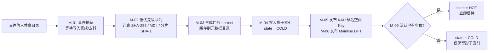
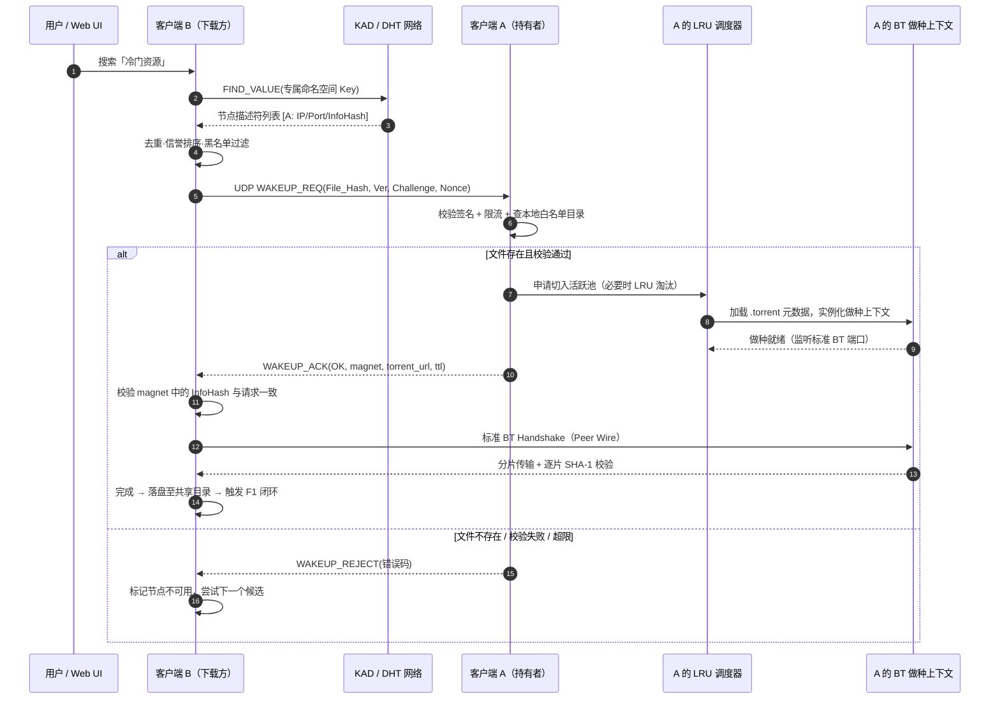
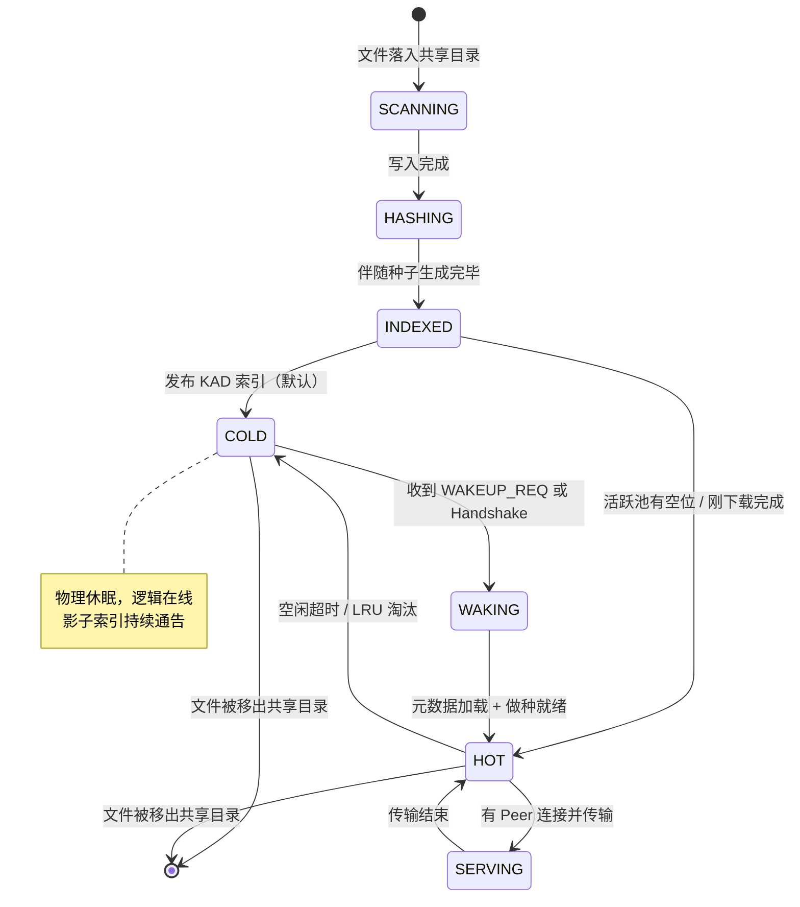

# 端到端流程与状态机（FLOWS）

> 编号 DOC-07 · 版本 2.0 · 状态 待评审 · 责任人 架构组 / 内核组 · 更新 2026-11-09
> 本文描述**运行时行为**；模块职责见 [LLD](LLD.md)，报文格式见 [PROTO](../04-protocol/PROTO.md)。

## 1. F1 文件入库与伴随造种

**关键约束**：文件重命名/修改会改变指纹，必须精确重算并重发索引；造种任务在系统 Idle 优先级执行，避免 4 GB 文件哈希抢占前台 I/O。

## 2. F2 搜索与发现

1. 用户输入关键词 → 本地分词、归一化（大小写、分隔符、繁简可选）→ 生成多个 `Keyword_Key`。
2. 向 KAD 发起 `FIND_VALUE`，获取节点描述符列表。
3. 结果与本地索引、黑名单、信誉分合并去重；按「在线概率 / 历史成功率 / 文件大小匹配度」排序。
4. 展示可选资源及其 InfoHash；用户也可直接粘贴 InfoHash / magnet 精确查找。

> **KAD 精确匹配陷阱**：KAD 关键词基于哈希精确匹配，不支持通配符与模糊查找。缓解手段是客户端侧分词后**逐词分别发布**多个 Key，并在结果侧做模糊重排与别名归一；代价是发布/查询量上升，因此需限制单词条数上限（默认 8）并对发布做限速（M0 压测确定，见 [OPEN-QUESTIONS Q2](../06-plan/OPEN-QUESTIONS.md)）。

## 3. F3 唤醒与激活（核心时序）

## 4. F4 标准下载与闭环

B 拿到的是**完全标准**的 magnet / `.torrent`；数据传输 100% 走 BT Peer Wire，ColdRevive 私有协议不再参与。下载完成的文件默认落入共享目录，立即触发 F1 自动造种、入库、发布——**每一次下载都在扩充网络的可发现资源总量**，这是对抗冷启动的产品级设计（[LLD §13](LLD.md)）。

## 5. F5 被动唤醒（兼容旧客户端 / 未发信令直连）

这条路径保证：**旧客户端即使完全不知道 ColdRevive 的存在，只要通过公共 DHT 或 magnet 连上来，也能把冷文件「叫醒」**。

## 6. F6 休眠切出

活跃上下文在「无数据交换 + 无新连接」持续 `idle_sleep_minutes`（默认 10 分钟）后：销毁连接与缓存、释放 Bitfield、状态回写 `COLD`；**KAD / Mainline DHT 的通告不撤销**，形成影子索引。会话级硬上限 `wake_session_ttl`（默认 2 小时）防止异常请求长期占用。

## 7. 文件状态机

状态值落库为 [DATA `files.state`](DATA.md)，实现约定见 [LLD §3 / §6](LLD.md)。

## 8. 异常与降级路径

| 场景 | 检测 | 降级行为 |
| :--- | :--- | :--- |
| 节点已离线 | UDP 唤醒超时 / TCP 不可达 | 立即切换下一候选，不阻塞 UI（避免长 TCP 超时） |
| 文件已被删除或改名 | 唤醒时索引命中但 stat 失败 | 返回 `REJECT_FILE_GONE`，撤销该 Key 的 KAD 发布 |
| 活跃池已满 | LRU 无空位且全忙 | 返回 `REJECT_BUSY` 并附重试建议；或淘汰最久未活跃者 |
| 内存 / 带宽超阈值 | M-13 采样越界 | 暂停新唤醒、降低后台限速、强制切出最冷项 |
| NAT 双向不可达 | M-07 判定 Symmetric NAT / CGNAT | LowID 回退：经中继节点转发信令；数据面限速并提示用户 |
| KAD 查询无结果 | `FIND_VALUE` 空 | 回退 Mainline DHT 精确查 → 可选 Tracker → 本地索引 |
| 返回种子哈希不符 | 元数据 / 分片校验失败 | 丢弃、拉黑节点、信誉扣分 |
| 索引污染 / 洪泛 | 结果异常率、请求频率超阈 | 限流 + 黑名单 + 只采信多重校验结果 |
| 造种队列积压 | 队列长度 > 阈值 | 降低并发、Idle 优先级、延迟发布（先索引后造种） |

> 错误码定义见 [PROTO §3](../04-protocol/PROTO.md)。本表是 [TEST 故障注入用例](../05-quality/TEST.md) 的需求来源。

## 相关文档

- [DOC-06 LLD 模块详细设计](LLD.md)
- [DOC-08 DATA 数据模型](DATA.md)
- [DOC-09 PROTO 协议规范](../04-protocol/PROTO.md)
- [DOC-12 TEST 测试计划](../05-quality/TEST.md)
