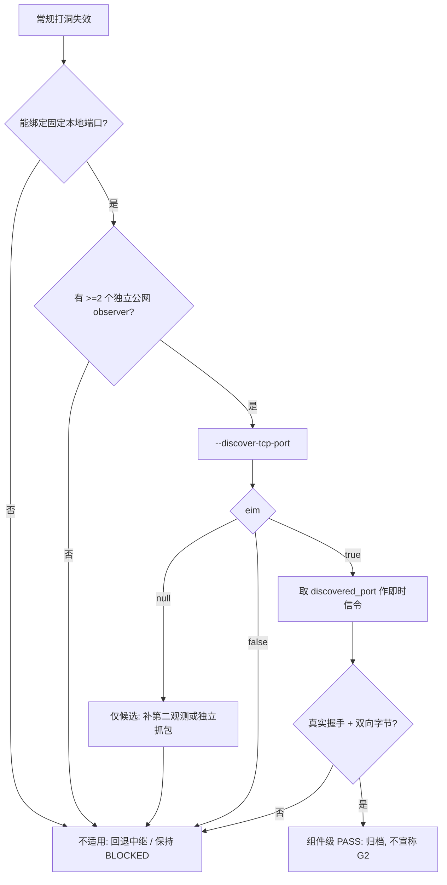

> 编号 DOC-30 · 版本 1.0 · 状态 **持续维护** · 责任人 内核组 / 测试组 / 运维组 · 更新 2026-11-24

# TCP 映射端口发现与 EIM 判定 Runbook

## 1. 目的与边界

本文把「常规打洞失效后，先用外部观测点发现 NAT 映射端口，再把该端口作为信令交给对端」固化为可复用的**应对方法**，并规定 EIM（endpoint-independent mapping，端点无关映射）的判定口径与 `coldrevive-nat` 的 CLI 参数。

**它回答**：这个出口的 TCP 源端口映射是否 endpoint-independent？映射成了哪个端口？发现端口能否作为对端回连的信令？

**它不回答**：这条路径能否算 NAT 矩阵通过？能否解锁 G2/S6？答案是**不能**。本方法只产出组件级证据；门禁常量始终为 `g2_claim=false`、`s6_status=not_run`、`evidence_valid_for_pass=false`、`auto_pass=false`。

背景与原始证据见 [阶段欠账复核 §20.3–20.5](../06-plan/STAGE-DEBT-AUDIT-2026-11-21.md) 与 [测试计划 §11](../05-quality/TEST.md)。

## 2. 术语与 EIM 判定表

| 术语 | 含义 |
| :--- | :--- |
| 固定本地端口 | 发现阶段与打洞阶段都由本机绑定并主动发起的源端口，如 `192.168.1.221:19910`。 |
| observer | 公网可达的 TCP 观测点。对每个入向连接回写 `CR-MAPPED <ip>:<port>`，其中端点为 `accept()` 看到的**映射后源端点**。 |
| 发现端口 | observer 回写的公网端口，是给对端的**信令字段**，不是配置里假设的端口。 |
| EIM | 同一本地端口对不同目的地址映射为同一公网端点；端口可能随会话变化，但在同一会话内对目的无关。 |

判定由 `cr_nat::tcp_discovery::judge_observations` 纯函数完成，与网络 I/O 解耦：

| 成功观测数 | 端点一致性 | `eim` | `discovered_port` | 允许结论 |
| ---: | :--- | :--- | :--- | :--- |
| 0（含未提供 observer） | — | `false` | `null` | **BLOCKED**：无证据，不合成端口。 |
| 1 | — | `null` | `P` | 只得到候选端口；**未证 EIM**。可用于同会话即时尝试，但必须经真实握手验证，不得外推、不得写成 EIM 已证。 |
| ≥2 | 一致 | `true` | `P` | EIM 成立（仅限本次本地端口 + 这些目的 + 此刻）。把 `P` 作为信令交给对端。 |
| ≥2 | 不一致 | `false` | `null` | 非 EIM / 映射随目的变化；**发现端口不可外推**，本方法不适用，回退中继。 |
| ≥2 | 一致但端点解析不出端口 | `false` | `null` | 观测数据损坏；按无证据处理。 |

`eim` 的三态必须原样保留：`null` 是「未证」，`false` 是「已反证或无证据」，`true` 是「已证」。JSON 输出中 `null` 不得被脚本改写成 `false`。

真实 EIM 证据示例：221 从 `192.168.1.221:19910` 分别连两个独立公网 IP，两台观测机 tcpdump 都看到 `112.5.60.4:20811`，判 EIM 成立；证据见 `tests/ARCHIVE/evidence/tcp-eim-two-observers-tcpdump-20261124.json`。注意早先抓到的 `18011` 是**另一会话**的映射端口，不是同一会话的端口漂移。

## 3. CLI 参数

两个模式互斥，命中后即返回，不在一次调用里与其它探测模式混用。

| 参数 | 参数值 | 默认值 | 说明 |
| :--- | :--- | :--- | :--- |
| `--serve-observer` | `<ip:port>` | 无 | observer 模式：监听并回写 `CR-MAPPED <peer>\n`。公网机建议绑 `0.0.0.0`，安全组只放通需要的观测端口。 |
| `--observer-secs` | `<秒>` | `20` | observer 存活秒数；只需覆盖发现窗口，打洞阶段不要求 observer 常驻。 |
| `--discover-tcp-port` | `<本地 ip:port> <observer ip:port[,ip:port...]>` | 无 | 客户端模式：从固定本地端口依次向每个 observer 发真 TCP 连接，读回映射端点。多个 observer 用逗号分隔。 |
| `--timeout` | `<毫秒>` | `3000` | 每个 observer 的连接 + 读回超时；发现模式内部下限 `500 ms`。 |
| `--json` | 无 | 关 | 输出稳定字段的 JSON；脚本必须按 JSON 解析，不要抓日志文本。 |

输出字段：

- observer：`mode`、`bind`、`served`、`write_failed`、`elapsed_ms`、`s6_status`。
- 发现：`mode`、`local`、`observations[]`（`observer` / `mapped_endpoint` / `error`）、`eim`、`discovered_endpoint`、`discovered_port`、`reason`、`s6_status`、`g2_claim`、`auto_pass`。
- 任何读不到、解析不出映射端点的 observer 都写入 `error`，不会合成 `mapped_endpoint`。

## 4. 适用性判断：常规方法失效时是否改用本办法



**触发条件**（常规方法已失效且出现下列现象之一）：

1. 入口 DNAT 已验证可承载双向 TCP，但 simultaneous-open 仍 `Connection refused`，抓包显示对端 SYN  destination 是配置端口而非实际映射端口（源端口被 PAT 改写）。
2. 上游设备没有「保持源端口 / 转换后源端口」选项，公网 IP 为多设备共用，无法做整主机 1:1 NAT。
3. 中继可用，但需要验证是否存在真实直连路径；目标只是组件级结论，不是 NAT 矩阵覆盖率。

**适用前提**（全部满足才进入探测）：

1. 本机可从固定源端口发起连接，且发现与打洞用**同一个**本地端口。
2. 至少两个公网观测点，优先不同 IP / 不同上游；安全组允许客户端连入 observer 端口。若只放通已有端口，可在该端口上做临时 REDIRECT 到 observer，跑完立即撤销并复测原服务。
3. 对端能收到发现端口，并在映射存活期内回连；对端自身若为对称 NAT，应保持主动连接方角色。
4. 已有真实握手与双向字节的验证手段（`--tcp-punch --echo` 或 `tests/e2e/w56/public_tcp_punch_discovered.py`）。

**不适用 / 立即停止**：

- observer 回写不一致 → `eim=false`，退出，不挑选其中一个端口「试运气」。
- 只有一个 observer → `eim=null`，不得写 EIM 已证；补第二观测点或独立 tcpdump 证据后再判。
- 无信令通道、映射生命周期短于信令往返时间、或本地端口无法重绑。
- 需求是 S6 矩阵覆盖或 G2 自动解禁 —— 本办法在原理上不产生这类证据。

## 5. 标准操作

以 221（本地 `192.168.1.221:19910`）和两个公网观测点为例：

```bash
# 1) 两台公网机分别启动 observer（端口按安全组实际放通值调整）
coldrevive-nat --serve-observer 0.0.0.0:19110 --observer-secs 120 --json
coldrevive-nat --serve-observer 0.0.0.0:19111 --observer-secs 120 --json

# 2) 221 从固定源端口发现映射端点
coldrevive-nat --discover-tcp-port 192.168.1.221:19910 \
  82.157.68.159:19110,119.29.150.254:19111 \
  --timeout 3000 --json

# 3) 只在 eim=true 时取 discovered_port，作为信令交给对端，立即打洞
python3 tests/e2e/w56/public_tcp_punch_discovered.py --report-out <路径>

# 4) 归档原始 JSON / tcpdump / 报告，并写明组件级边界
python3 scripts/archive_test_run.py --evidence <路径> --notes "组件级发现端口打洞；不宣称 G2"
```

若安全组限制导致 observer 无法直连，可沿用 v2.4.120 的做法：在已放通端口上临时 REDIRECT 到 observer，发现完成后撤销并确认原端口服务恢复。真实实验里双观测点 EIM 用 tcpdump 抓 SYN 取证，发现端口用 82 的临时 REDIRECT 取证，两者互相印证。

## 6. 测试策略：不要只靠全量串行

全量串行是最终回归，不是本方法的日常判据。按顺序先跑下面两层定点测试：

```bash
# A) Rust 定点单测：判定纯函数 + observer 回写 + 异常输入（秒级）
CARGO_INCREMENTAL=0 cargo test --offline -p cr-nat tcp_discovery -- --nocapture

# B) CLI 回环冒烟：双观测一致 / 单观测未证 / 不可达 / 不一致不出端口（6 项）
CARGO_INCREMENTAL=0 cargo build --offline -p coldrevive-nat
python3 tests/e2e/w56/tcp_discovery_selftest.py \
  --bin target/debug/coldrevive-nat \
  --report-out tests/e2e/w56/reports/tcp-discovery-selftest.json

# C) 最终回归（可选，不能替代 A/B）
CARGO_INCREMENTAL=0 cargo test --workspace --offline -- --test-threads=1
```

A 覆盖 `judge_observations` 的全部四态、`parse_port` 拒绝 0/垃圾值、observer 回写格式、无前缀/坏端口/空回写、不可达 observer、JSON 门禁常量。B 在真实 CLI 上覆盖 observer 进程、参数解析、JSON 输出和「不一致不合成端口」。C 只用于确认没有跨模块回归；默认并行下既存计时型 flaky 不等于本方法失败。

**B 的回环 PASS 只证明控制路径正确，不证明 NAT EIM。** NAT EIM 仍必须由公网双观测点证据（`tcp-eim-two-observers-tcpdump-20261124.json`）或等价真实抓包证明。

## 7. 实测边界与回退

- v2.4.120 首次发现端口 `112.5.60.4:21211` 作信令，222 回连该端口而非固定 `19910`，两侧 `ok=true` + `bytes_roundtrip=true`，连续 3 轮带 tcpdump 全 PASS；证据 `tests/ARCHIVE/evidence/tcp-punch-discovered-3rounds-verify-20261124.json`。
- 221 的 EIM 不外推到 222：222 仍是对称出口，必须保持主动连接方。
- 发现端口有生命周期，必须即时使用；跨会话重连要重新发现，不缓存旧端口。
- 任一失败分支都回退中继，并把 `eim` / `reason` / `error` 原文归档；不得把 BLOCKED 改写成 PASS，不得通过重复抽样「碰运气」。

## 8. 相关文档

- [阶段欠账复核 §20.5](../06-plan/STAGE-DEBT-AUDIT-2026-11-21.md)
- [测试计划 §11](../05-quality/TEST.md)
- [CLI 自测脚本](../../tests/e2e/w56/tcp_discovery_selftest.py)
- [发现端口打洞探针](../../tests/e2e/w56/public_tcp_punch_discovered.py)
