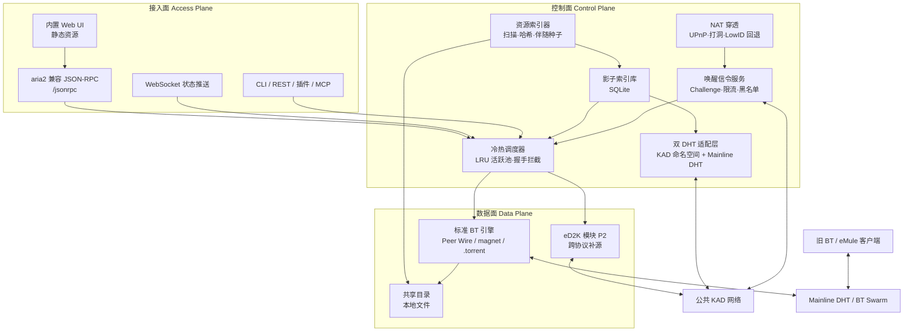
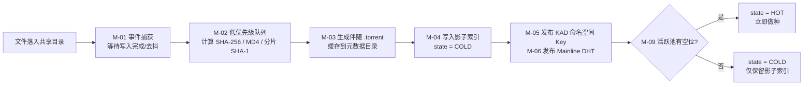
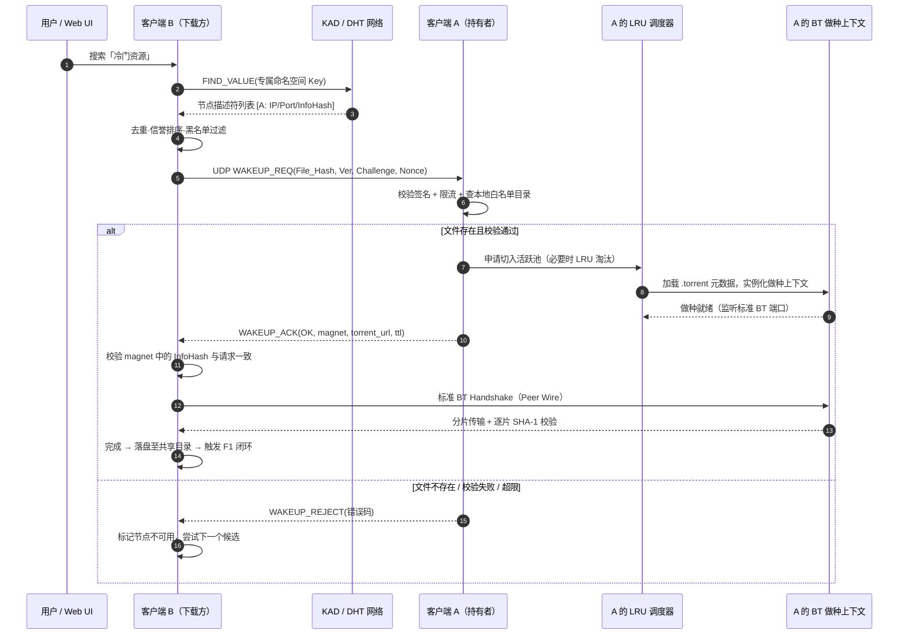
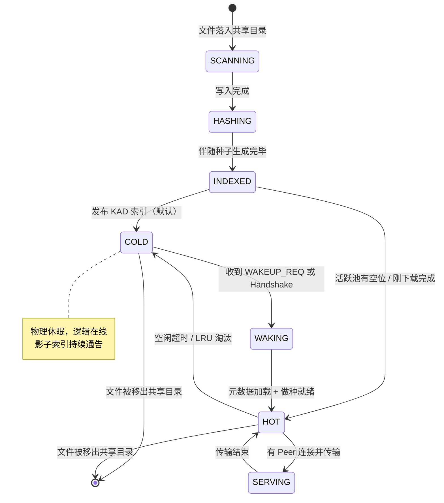

# ColdRevive 项目开发文档（完整版 v2.0）

| 项目 | 内容 |
| :--- | :--- |
| 项目名称 | **ColdRevive**（冷种复活计划） |
| 文档版本 | v2.0（Consolidated Spec，待评审） |
| 日期 | 2026-11-09 |
| 来源 | `chat.md` 全部讨论轮次（aria2 预研 → Rust/eD2K 生态 → BT 搜索 → 冷种问题 → 架构收敛 → 工程细化 → hMule 复盘） |
| 取代 | `chat.md` 第 584–739 行的《ColdRevive 客户端开发设计文档 v1.0》 |
| 状态 | 设计冻结候选，M0 Spike 后转基线 |
| 适用范围 | 客户端内核、控制面协议、数据面兼容、内置 UI/RPC、测试与发布 |

> **文档定位**：本文件是 ColdRevive 的**单一权威开发文档**，一份文件内覆盖 PRD、架构、详细设计、协议规范、技术选型、测试、里程碑、风险与运维。团队扩张后可按第 0 章拆分为独立文档，届时本文件退化为索引页。
>
> **合规前提**：本项目是实现通用 P2P 传输与索引协议的开源工具，不内置任何资源站点、索引库或默认搜索源，不提供绕过版权保护的能力。详见 [11.6 合规与伦理边界](#116-合规与伦理边界)。

---

## v2.0 相对 v1.0 的变更摘要

| # | v1.0 状态 | v2.0 修订 | 来源讨论 |
| :--- | :--- | :--- | :--- |
| 1 | 依赖「私有 RPC 主动唤醒」作为主路径 | 确立**「常态共享目录（体验层）+ 按需唤醒（实现层）」双层模型**，二者不是二选一 | 共享目录 / 阈值两轮 |
| 2 | 未解决「BT 基于种子而非文件」的硬壁垒 | 新增 **伴随种子生成（Companion Torrent Generation）**，文件入库即造种，元数据可分发 | 共享目录轮 |
| 3 | 活跃做种数量无约束 | 新增 **冷热分级 + LRU 活跃池 + 影子索引 + 握手拦截**，目标 1 万文件常驻 ≤100 MB | 阈值轮 |
| 4 | 仅描述 KAD 发布/查询 | 新增 **分层 DHT 模型**：KAD 发现 / 私有 RPC 激活 / Mainline DHT 兼容 / Tracker 可选；明确 128-bit 与 160-bit ID 空间不兼容 | 广播轮 |
| 5 | 安全仅列 3 条 | 扩充为完整威胁模型、Challenge-Response、限流、信誉与黑名单 | 全篇 |
| 6 | 未涉及冷启动 | 新增 **hMule 失败复盘**与冷启动/生态借力策略，列为头号非技术风险 | hMule 轮 |
| 7 | UI 选型仅列出 Tauri/GPUI | 吸收 aria2 预研结论：**守护进程内嵌 HTTP/WS 服务，同端口托管静态 UI + `/jsonrpc`，WebSocket 推送替代轮询**，对外兼容 aria2 JSON-RPC 生态 | aria2 四轮 |
| 8 | 里程碑 3 阶段 | 细化 M0–M5、WBS、退出门禁、KPI、测试矩阵、风险登记册、ADR | 本次补全 |

---

## 0. 文档体系规划

### 0.1 文档清单与拆分建议

当前以单文件交付；当贡献者 ≥ 5 人或进入 M2 时，按下列边界拆分。

| 编号 | 文档 | 主要内容 | 本文件对应章节 | 拆分时机 |
| :--- | :--- | :--- | :--- | :--- |
| DOC-01 | 产品需求说明书 PRD | 背景、目标/非目标、用户故事、KPI | 1、2 | M2 |
| DOC-02 | 总体架构设计 ARCH | 分层、进程视图、模块边界、ADR | 3、12 | M1 立即 |
| DOC-03 | 模块详细设计 LLD | 各模块状态机、算法、参数 | 5 | M1 |
| DOC-04 | 协议规范 PROTO | KAD KV、唤醒 RPC、JSON-RPC、错误码 | 6 | M1 立即 |
| DOC-05 | 数据模型 DATA | SQLite Schema、迁移策略 | 6.2、11.3 | M1 |
| DOC-06 | 接口与生态 API | Web UI、CLI、REST/OpenAPI、浏览器插件、MCP | 5.12、6.5 | M3 |
| DOC-07 | 测试计划 TEST | 分层、环境、矩阵、基线、门禁 | 9 | M1 |
| DOC-08 | 风险登记册 RISK | 风险矩阵与缓解 | 8 | 立即维护 |
| DOC-09 | 开发计划 ROADMAP | WBS、里程碑、门禁 | 10 | 立即维护 |
| DOC-10 | 运维与发布 OPS | 打包、配置、监控、升级、合规 | 11 | M3 |
| DOC-11 | 决策记录 ADR | 每项关键技术抉择的上下文与后果 | 3.5、12 | 持续追加 |

### 0.2 按角色的阅读路径

- **架构师 / 新贡献者**：0 → 1 → 3 → 4 → 12
- **内核开发（Rust）**：3 → 4 → 5 → 6 → 9
- **前端 / UI**：3.3 → 5.12 → 6.5 → 7.4
- **测试**：2.4 KPI → 4.8 异常表 → 9
- **运维 / 发布**：6.6 配置 → 10 → 11
- **评审者 / 决策者**：1.5 关键结论 → 3.5 ADR → 8 风险 → 13 待决问题

---

## 1. 项目总览

### 1.1 问题定义

**BT 是「文件分发系统」，eMule 是「内容保留系统」**，两者的差异来自网络架构而非实现优劣。

| 维度 | eMule / eD2K + KAD | BitTorrent / DHT |
| :--- | :--- | :--- |
| 索引形态 | 分布式**目录**（关键词字典 + 文件索引字典） | 分布式**地址簿**（精确 InfoHash → Peer） |
| 搜索 | 协议原生，关键词匹配 | 协议外挂，依赖第三方爬虫/索引站 |
| 索引单位 | **文件**（MD4 文件哈希） | **种子**（InfoHash），文件名可变 |
| 激励机制 | 积分 / 排队，奖励长期在线共享 | Tit-for-Tat，奖励快速交换，下载完即离场 |
| 冷门资源 | 只要有一人持有，慢但可下 | 热度一过即死种（讨论中引用的种子寿命量级为 9–13 天，M0 核实） |

由此产生两个具体缺口：

1. **发现缺口**：DHT 的键是哈希，不是文件名，无法在协议内做关键词检索。BT 生态的搜索能力全部来自「外挂」爬虫（Bitmagnet、magnetico 等）或中心化站点。
2. **供给缺口**：即使找到了 InfoHash，若所有持有者已停止做种，DHT 只能返回空列表。已有缓解手段（BitComet 长效种子、BiglyBT Swarm Merging、跨协议补源、归档做种、悬赏恢复）都只是打补丁，缺少协议内的持久性动力。

### 1.2 价值主张

> **「把文件放进共享目录，它就永远能被搜到、被下到。」**

ColdRevive 不修改任何现有协议，而是在应用层构建一条**私有控制面**：以 KAD 为去中心化黄页做发现，以轻量私有信令做激活，把标准 BT / eD2K 当作纯粹的数据管道。对下载方是「像 eMule 一样搜索，像 BT 一样高速」，对旧客户端是「一个忽然活过来的普通做种者」。

### 1.3 目标与非目标

| 目标（In Scope） | 非目标（Out of Scope） |
| :--- | :--- |
| 共享目录自动索引、自动造种、自动发布 | 修改 BT / eD2K / KAD 核心协议或报文格式 |
| 基于 KAD 命名空间的关键词与文件哈希检索 | 建设中心化搜索站、内置资源源或默认节点列表 |
| 私有唤醒信令 + 按需切入做种 | 让离线客户端「被唤醒」（物理上不可能，只能依赖在线节点） |
| 冷/热分级、内存与带宽阈值治理 | v1 实现完整 eMule 积分/排队/上传体系 |
| 对旧 BT / eMule 客户端透明兼容 | v1 支持移动端、Web 纯网页客户端 |
| 内置 Web UI + aria2 兼容 JSON-RPC + 浏览器插件 | 引入代币 / 链上激励（仅在 ADR-005 中评估） |
| 影子索引、NAT 穿透、基础抗污染 | 规避版权保护、绕过地域限制或提供匿名化保证 |

### 1.4 核心设计原则

| ID | 原则 | 含义 |
| :--- | :--- | :--- |
| P1 | **零协议侵入** | 绝不改 BT/eD2K 传输协议；只加应用层控制面 |
| P2 | **向下兼容** | 唤醒后产出标准 `.torrent` / magnet / ed2k 链接，旧客户端拿链接即可下载 |
| P3 | **控制面/数据面分离** | KAD + 私有信令负责「找谁、叫醒谁」；标准协议负责「传数据」 |
| P4 | **双层共享模型** | 用户看到的是常态共享目录；底层实现是按需唤醒。二者分层，不是替代关系 |
| P5 | **影子索引** | 冷文件物理休眠、逻辑永远在线：KAD/DHT 通告不撤销 |
| P6 | **资源有界** | 内存、连接数、上行带宽、造种 CPU、唤醒并发，一切皆有硬阈值与降级路径 |
| P7 | **零信任网络** | DHT 返回值、唤醒响应、种子元数据、下载分片，一律校验后才采信 |
| P8 | **生态借力** | 复用公共 KAD 引导节点、Mainline DHT、aria2 JSON-RPC 生态，避免冷启动从零造网 |

### 1.5 讨论沉淀的八条决策性结论

| ID | 结论 | 对设计的约束 |
| :--- | :--- | :--- |
| C1 | 把 KAD 当黄页、BT/eD2K 当管道，是「降维打击」式可行路径 | 控制面与数据面必须解耦为独立模块 |
| C2 | **DHT 是雷达，私有唤醒 RPC 是激活信号**；hMule 只做发现故失败 | 唤醒协议是 P0 必做，不可被「纯广播」取代 |
| C3 | 旧客户端不需要理解 ColdRevive | 所有对外产物必须是标准链接与标准握手 |
| C4 | 只把文件放进共享目录仍无法下载——BT 缺分片元数据 | 必须实现伴随种子生成与元数据分发 |
| C5 | 1 万文件全量做种会撑爆客户端 | 冷热分级 + LRU + 握手拦截，目标 ≤100 MB |
| C6 | 分层用 DHT，而非完全取代 Tracker | KAD 发现 / RPC 激活 / Mainline DHT 兼容 / Tracker 可选加速 |
| C7 | Web UI 与 RPC 是共生关系；性能瓶颈在轮询而非 UI 位置 | 内置 HTTP/WS 服务，状态推送一律走 WebSocket |
| C8 | 最大风险不是技术，是**冷启动网络效应** | 必须先提供「不依赖他人也存在」的单机价值 |

### 1.6 典型用户故事

| ID | 角色 | 故事 | 验收要点 |
| :--- | :--- | :--- | :--- |
| US-01 | 分享者 | 我把下载完的文件留在共享目录，别人就能搜到 | 文件落盘后 N 秒内完成造种、入库、KAD 发布 |
| US-02 | 下载者 | 我输入关键词，找到一台持有该资源的在线节点 | 结果含节点地址、文件哈希、大小、健康度 |
| US-03 | 下载者 | 我点下载，对方即使没在做种也能被激活 | 唤醒 → 拿到标准 magnet → 完成下载，全链路可观测 |
| US-04 | 旧客户端用户 | 我拿到一个 magnet，用 qBittorrent 也能下 | 无需安装 ColdRevive，标准 DHT/握手可用 |
| US-05 | 重度分享者 | 我共享 1 万个文件，日常内存和网速不受影响 | 空闲内存 ≤100 MB，后台上行 ≤20%，前台速率影响 ≤5% |
| US-06 | 笔记本用户 | 我关掉 UI 窗口，后台共享和下载不中断 | 守护进程独立常驻，UI 进程可随时退出 |
| US-07 | 运维/极客 | 我用 AriaNg 或浏览器插件接管下载 | aria2 兼容 JSON-RPC + WebSocket 可直连 |
| US-08 | 安全评审 | 恶意节点伪造索引/洪泛唤醒时客户端不崩 | 校验失败丢弃并拉黑，限流生效，内存不越界 |

---

## 2. 需求规格

### 2.1 功能性需求

| ID | 需求 | 优先级 | 验收要点 |
| :--- | :--- | :--- | :--- |
| FR-01 | 监控共享目录，增量识别新增/修改/删除文件 | P0 | inotify / FSEvents 事件驱动，无全盘轮询 |
| FR-02 | 计算文件指纹：SHA-256 / eD2K(MD4) / BT 分片哈希 | P0 | 结果与标准工具交叉验证一致 |
| FR-03 | 为每个共享文件生成伴随 `.torrent`（v1，v2 可选） | P0 | 生成的种子可被 qBittorrent 正常解析 |
| FR-04 | 本地索引库持久化元数据与做种状态 | P0 | 重启后无需重算即可恢复 |
| FR-05 | 生成 KAD 专属命名空间 Key 并定期发布节点描述符 | P0 | 断电重启后可按 TTL 自动续期 |
| FR-06 | 关键词分词 → 多 Key 发布与查询 | P0 | 中文/英文/分隔符混合场景可命中 |
| FR-07 | KAD `FIND_VALUE` 查询、结果去重、健康度排序 | P0 | 返回候选节点列表与可信度标记 |
| FR-08 | 私有唤醒信令 `WAKEUP_REQ / ACK / REJECT` | P0 | UDP 轻量请求，避免 TCP 长超时 |
| FR-09 | Challenge-Response 校验、按 IP 限流、黑名单 | P0 | 伪造签名请求被拒且记入日志 |
| FR-10 | 冷文件按需切入 LRU 活跃做种池 | P0 | 池满时淘汰最久未活跃者 |
| FR-11 | 接入层 BT 握手拦截，按 InfoHash 触发被动唤醒 | P0 | 旧客户端直接连入也能唤醒成功 |
| FR-12 | 生成并返回标准 magnet / `.torrent` / ed2k 链接 | P0 | 元数据可通过 HTTP 接口或 `xs` 参数拉取 |
| FR-13 | 内置标准 BT 下载/做种引擎，支持暂停/恢复 | P0 | 完成的文件自动回流共享目录形成闭环 |
| FR-14 | 空闲 N 分钟自动切出休眠，保留影子索引 | P0 | 休眠后 KAD 仍可查到该节点 |
| FR-15 | 内存/连接/带宽/造种 CPU 阈值控制与降级 | P0 | 阈值可配置，超限自动拒绝新唤醒 |
| FR-16 | 后台做种 QoS：令牌桶限速 + uTP/LEDBAT 退让 | P1 | 前台下载与游戏延迟不受明显影响 |
| FR-17 | UPnP / NAT-PMP 端口映射、UDP 打洞、LowID 回退 | P1 | 常见家用路由器 NAT 矩阵通过 |
| FR-18 | 同时向 Mainline DHT 发布 Peer 信息 | P1 | 旧客户端可经标准 DHT 找到被激活的节点 |
| FR-19 | 内置 Web UI（搜索、任务、共享目录、状态监控、设置） | P1 | 单端口访问，关闭界面不影响后台 |
| FR-20 | aria2 兼容 JSON-RPC（含 `rpc-secret` 鉴权与 CORS 控制） | P1 | AriaNg / Aria2 Explorer 可直接接入 |
| FR-21 | WebSocket 状态推送（禁止高频 HTTP 轮询） | P1 | 空闲时 RPC 请求数趋近 0 |
| FR-22 | CLI、REST/OpenAPI、浏览器插件接口 | P2 | 覆盖自动化与「浏览即下载」场景 |
| FR-23 | 跨协议补源：从 eD2K 网络补齐 BT 缺失分片 | P2 | 需哈希转译层，v2 评估后再排期 |
| FR-24 | 节点信誉、贡献积分、冷启动激励 | P2 | 抗女巫，防刷分，见 ADR-005 |

### 2.2 非功能性需求

| ID | 类别 | 指标 |
| :--- | :--- | :--- |
| NFR-01 | 内存 | 1 万个共享文件、纯空闲常驻 ≤ 100 MB；硬上限 200 MB |
| NFR-02 | CPU | 空闲态平均 CPU ≤ 2%；造种任务仅以 Idle 优先级运行 |
| NFR-03 | 带宽 | 后台做种上行 ≤ 配置阈值（默认总上行 20%）；前台吞吐劣化 ≤ 5% |
| NFR-04 | 时延 | 唤醒 P95 < 3 s（局域网），公网 P95 < 8 s |
| NFR-05 | 容量 | 索引库支持 ≥ 50,000 文件；KAD 发布队列支持 ≥ 10,000 条 |
| NFR-06 | 可靠性 | 守护进程 72 h Soak 无泄漏、无崩溃；崩溃后索引可恢复 |
| NFR-07 | 兼容性 | Windows / macOS / Linux；qBittorrent、Transmission、BitComet、eMule 互通 |
| NFR-08 | 安全 | 所有外部输入校验；签名、限流、黑名单默认开启；无远程代码执行面 |
| NFR-09 | 隐私 | 共享目录白名单机制；未显式加入目录的文件绝不发布；日志不记录完整路径 |
| NFR-10 | 可维护性 | Rust 工作空间分 crate；核心模块单测覆盖率 ≥ 70%；协议有版本字段 |
| NFR-11 | 可观测性 | 结构化日志 + 指标导出；每个唤醒请求有 trace id 可端到端追踪 |
| NFR-12 | 交付 | 单守护进程二进制 + 可选 UI，安装包目标 ≤ 60 MB（参考同类 Rust 客户端量级） |

### 2.3 约束与假设

- **A1**：eMule KAD 与 Mainline DHT 均基于 Kademlia，但 **ID 空间不兼容（KAD 128-bit / Mainline 160-bit）**，不能直接互相写入；必须有映射/双栈层（M0 复核）。
- **A2**：复用公共 KAD 网络做引导与存储，但不假设其可用性；需支持自建/私有命名空间切换。
- **A3**：KAD Value 容量有限，**不存放种子文件本体**，只存轻量节点描述符；元数据经 HTTP 接口或 magnet `xs` 分发。
- **A4**：无法唤醒离线节点；服务的可用性上界 = 在线节点比例 × NAT 可达率。
- **A5**：所有阈值默认值以「个人/小团队」规模设定，可按配置放大。
- **A6**：讨论中引用的第三方项目（`rqbit`、`ed2k-rs`、FluxDown、hMule、BitComet 长效种子、BEP-55 等）能力描述需在 M0 逐项核实，不直接作为设计前提。

### 2.4 全局验收指标（KPI）

| 指标 | 目标 | 测量方式 |
| :--- | :--- | :--- |
| 受控环境死种复活成功率 | 100%（局域网双节点）、≥ 90%（公网多节点） | M1/M4 自动化用例集 |
| 唤醒 P95 时延 | < 3 s / < 8 s | 埋点 trace |
| 1 万文件空闲常驻内存 | ≤ 100 MB | 压测 72 h RSS |
| 后台上行占用 | ≤ 配置阈值，无超限尖峰 | 令牌桶统计 |
| 搜索结果有效率 | 校验通过率 ≥ 95% | 污染注入测试 |
| 旧客户端兼容通过率 | 100%（兼容性矩阵全绿） | 矩阵回归 |
| 恶意唤醒洪泛下存活 | 内存不越界、服务不中断 | 安全压测 |

---

## 3. 总体架构

### 3.1 控制面 / 数据面 / 接入面总览



### 3.2 分层架构

| 层 | 名称 | 职责 | 关键模块 |
| :--- | :--- | :--- | :--- |
| L0 | 基础设施 | 异步运行时、文件系统监控、加密哈希、配置、日志 | Tokio、notify、SQLite、tracing |
| L1 | 存储与索引 | 共享目录 → 指纹 → 伴随种子 → 影子索引 | Indexer、TorrentGen、IndexDB |
| L2 | 发现与网络 | 双 DHT 发布/查询、命名空间、NAT 连通性 | KAD Adapter、Mainline Adapter、NAT |
| L3 | 信令与激活 | 私有唤醒协议、鉴权、限流、信誉 | WakeServer、WakeClient、Reputation |
| L4 | 调度与治理 | 冷热分级、LRU、握手拦截、阈值/QoS | SeedScheduler、HandshakeGuard、QoS |
| L5 | 数据面 | 标准 BT 下载/做种、可选 eD2K 补源 | BT Engine、eD2K Adapter |
| L6 | 接入与生态 | Web UI、JSON-RPC、WS、CLI、插件、MCP | HttpServer、RpcBridge、UI |
| L7 | 横切 | 安全、隐私、可观测性、合规 | 全层 |

### 3.3 进程与部署视图

借鉴 FluxDown 的「引擎与界面彻底分离」，同时吸收 aria2 预研结论——**我们自建 Rust 守护进程，因此可原生内嵌 HTTP/WS 服务，无需修改任何 C++ 源码，也无需伴生进程分发**。

| 进程 | 生命周期 | 职责 | 关闭影响 |
| :--- | :--- | :--- | :--- |
| `coldrevived` | 常驻守护 | 引擎、索引库、DHT、唤醒服务、HTTP/WS/RPC 服务 | 停止即停止共享与下载 |
| `coldrevive-agent` | 常驻轻量 | 系统托盘、浏览器下载捕获、UPnP 续租、守护进程看护 | UI 不受影响 |
| `coldrevive-desktop` / 浏览器页面 | 按需 | 纯界面（Tauri 或纯 Web UI） | **关闭不影响后台下载/做种** |

**单端口设计**：守护进程在同一监听端口上按路径分流——

| 路径 | 用途 |
| :--- | :--- |
| `/`、`/assets/*` | 内置静态 Web UI（资源编译期嵌入二进制，单文件交付） |
| `/jsonrpc` | aria2 兼容 JSON-RPC（HTTP POST） |
| `/ws` | WebSocket 状态推送（任务进度、速度、节点事件） |
| `/torrent/<infohash>` | 按 InfoHash 拉取伴随种子元数据 |
| `/api/v1/*` | REST/OpenAPI（搜索、共享目录、配置、指标） |

> **性能结论（来自 aria2 讨论）**：静态 UI 文件对服务器开销可忽略；真正决定 CPU 的是 RPC 通信协议。曾有 HTTP 轮询经隧道导致 CPU 约 90% 的案例，切换 WebSocket 后显著下降。因此 ColdRevive **强制以 WebSocket 推送状态，禁止 UI 高频轮询**；`rpc-secret` 鉴权与 CORS 白名单默认开启。

**默认端口（可配置）**

| 端口 | 协议 | 用途 |
| :--- | :--- | :--- |
| 16800/tcp | HTTP / WS | UI、JSON-RPC、REST |
| 16801/udp | 私有唤醒信令 + KAD | 轻量唤醒、DHT 通信 |
| 16802/tcp+udp | BT Peer Wire / uTP | 标准做种与下载 |
| 16803/tcp+udp | eD2K（P2，可选） | 跨协议补源 |

### 3.4 模块清单

| ID | 模块 | 层 | 核心职责 | 依赖 |
| :--- | :--- | :--- | :--- | :--- |
| M-01 | `cr-indexer` 共享目录监控 | L1 | 事件驱动增量扫描、白名单、变更检测 | M-03 |
| M-02 | `cr-hash` 指纹计算 | L1 | SHA-256 / MD4(eD2K) / BT 分片 SHA-1，Idle 优先级 | M-01 |
| M-03 | `cr-torrent` 伴随种子生成 | L1 | 分片、InfoHash、`.torrent` 序列化与缓存 | M-02 |
| M-04 | `cr-store` 影子索引库 | L1 | SQLite Schema、迁移、冷热状态持久化 | — |
| M-05 | `cr-kad` KAD 适配 | L2 | 命名空间 Key、发布/续期/查询、结果去重 | M-04 |
| M-06 | `cr-dht` Mainline DHT 适配 | L2 | Peer 发布、160-bit ID 映射、兼容旧客户端 | M-03 |
| M-07 | `cr-nat` 连通性 | L2 | UPnP/NAT-PMP、UDP 打洞、HighID/LowID 判定 | — |
| M-08 | `cr-wake` 唤醒信令 | L3 | UDP RPC、Challenge-Response、限流、黑名单 | M-04, M-07 |
| M-09 | `cr-sched` 冷热调度 | L4 | LRU 活跃池、切入/切出、阈值与降级 | M-04, M-10 |
| M-10 | `cr-guard` 握手拦截 | L4 | 无状态 Reactor、解析 Handshake InfoHash、被动唤醒 | M-04 |
| M-11 | `cr-engine` BT 引擎 | L5 | 标准下载/做种、暂停/恢复、分片校验 | M-03 |
| M-12 | `cr-ed2k` 跨协议补源（P2） | L5 | MD4 分块 → BT 分片的哈希转译与拼接 | M-11 |
| M-13 | `cr-qos` 资源治理 | L4 | 令牌桶、uTP/LEDBAT、内存/连接/CPU 阈值 | 全层 |
| M-14 | `cr-api` 接入层 | L6 | HTTP 静态服务、WS、JSON-RPC、REST、CLI | 全层 |
| M-15 | `cr-reputation` 信誉（P2） | L3 | 节点评分、贡献积分、抗女巫 | M-08 |
| M-16 | `cr-ui` Web UI | L6 | 搜索、任务、共享目录、状态、设置 | M-14 |

### 3.5 架构决策摘要（ADR 索引）

| ID | 决策 | 选择 | 主要理由 | 详见 |
| :--- | :--- | :--- | :--- | :--- |
| DR-01 | 常态共享 vs 按需唤醒 | **两者分层并存** | 用户要 eMule 式直觉，系统要有界资源 | 4、5.6 |
| DR-02 | 唤醒 RPC 是否保留 | **保留，P0** | hMule 只做发现而失败；DHT 无法激活冷节点 | 1.5 C2 |
| DR-03 | DHT 策略 | **三层 + Tracker 可选** | KAD 发现 / RPC 激活 / Mainline 兼容 | 5.4 |
| DR-04 | UI 交付形态 | **守护进程内嵌 HTTP/WS，前后端分离但单二进制** | 免 C++ 改造、免伴生分发、UI 可关 | 3.3 |
| DR-05 | 状态更新机制 | **WebSocket 推送，禁用轮询** | 轮询是 CPU 主要瓶颈 | 7.4 |
| DR-06 | 进程模型 | **守护进程 + 轻量 Agent + 可关 UI** | 关窗不断下载 | 3.3 |
| DR-07 | 元数据分发 | **KAD 只存描述符，种子走 HTTP / `xs`** | DHT Value 容量有限 | 6.3 |
| DR-08 | 语言/运行时 | **Rust + Tokio** | 高并发网络、哈希计算、内存安全 | 7.1 |

---

## 4. 端到端核心流程

### 4.1 F1 文件入库与伴随造种



**关键约束**：文件重命名/修改会改变指纹，必须精确重算并重发索引；造种任务在系统 Idle 优先级执行，避免 4 GB 文件哈希抢占前台 I/O。

### 4.2 F2 搜索与发现

1. 用户输入关键词 → 本地分词、归一化（大小写、分隔符、繁简可选）→ 生成多个 `Keyword_Key`。
2. 向 KAD 发起 `FIND_VALUE`，获取节点描述符列表。
3. 结果与本地索引、黑名单、信誉分合并去重；按「在线概率 / 历史成功率 / 文件大小匹配度」排序。
4. 展示可选资源及其 InfoHash；用户也可直接粘贴 InfoHash / magnet 精确查找。

> **KAD 精确匹配陷阱**：KAD 关键词基于哈希精确匹配，不支持通配符与模糊查找。缓解手段是客户端侧分词后**逐词分别发布**多个 Key，并在结果侧做模糊重排与别名归一；代价是发布/查询量上升，因此需限制单词条数上限（默认 8）并对发布做限速（M0 压测确定）。

### 4.3 F3 唤醒与激活（核心时序）



### 4.4 F4 标准下载与闭环

B 拿到的是**完全标准**的 magnet / `.torrent`；数据传输 100% 走 BT Peer Wire，ColdRevive 私有协议不再参与。下载完成的文件默认落入共享目录，立即触发 F1 自动造种、入库、发布——**每一次下载都在扩充网络的可发现资源总量**，这是对抗冷启动的产品级设计。

### 4.5 F5 被动唤醒（兼容旧客户端 / 未发信令直连）


这条路径保证：**旧客户端即使完全不知道 ColdRevive 的存在，只要通过公共 DHT 或 magnet 连上来，也能把冷文件「叫醒」**。

### 4.6 F6 休眠切出

活跃上下文在「无数据交换 + 无新连接」持续 `idle_sleep_minutes`（默认 10 分钟）后：销毁连接与缓存、释放 Bitfield、状态回写 `COLD`；**KAD / Mainline DHT 的通告不撤销**，形成影子索引。会话级硬上限 `wake_session_ttl`（默认 2 小时）防止异常请求长期占用。

### 4.7 文件状态机



### 4.8 异常与降级路径

| 场景 | 检测 | 降级行为 |
| :--- | :--- | :--- |
| 节点已离线 | UDP 唤醒超时 / TCP 不可达 | 立即切换下一候选，不阻塞 UI（避免长 TCP 超时） |
| 文件已被删除或改名 | 唤醒时索引命中但 stat 失败 | 返回 `REJECT_FILE_GONE`，撤销该 Key 的 KAD 发布 |
| 活跃池已满 | LRU 无空位且全忙 | 返回 `REJECT_BUSY` 并附重试建议；或淘汰最久未活跃者 |
| 内存 / 带宽超阈值 | M-13 采样越界 | 暂停新唤醒、降低后台限速、强制切出最冷项 |
| NAT 双向不可达 | M-07 判定 Symmetric NAT / CGNAT | LowID 回退：经中继节点转发信令；数据面限速并提示用户 |
| KAD 查询无结果 | `FIND_VALUE` 空 | 回退 Mainline DHT 精确查 → 可选 Tracker → 本地索引 |
| 返回种子哈希不符 | 元数据 / 分片校验失败 | 丢弃、拉黑节点、信誉扣分 |
| 索引污染 / 洪泛 | 结果异常率、请求频率超阈 | 限流 + 黑名单 + 只采信多重校验结果 |
| 造种队列积压 | 队列长度 > 阈值 | 降低并发、Idle 优先级、延迟发布（先索引后造种） |

---

## 5. 模块详细设计

### 5.1 M-01 共享目录监控器

- **输入**：用户显式配置的共享目录白名单（默认 `~/ColdRevive/Shared`）；**绝不扫描目录外文件**（NFR-09）。
- **事件**：`Create` / `Modify` / `Delete` / `Rename`；跨平台用 `notify` crate（inotify / FSEvents / ReadDirectoryChangesW）。
- **去抖**：新增文件在「写入完成」（连续 N 秒无 Modify 事件，默认 3 s）后才入队，避免对未完成的大文件造种。
- **变更处理**：修改/重命名 → 标记旧记录 `STALE` → 重算指纹 → 撤销旧 KAD 发布 → 发布新 Key。
- **排除规则**：隐藏文件、`.part`/`.crdownload` 临时文件、符号链接逃逸、小于阈值的文件（默认 1 MB）可配置跳过。
- **接口**：`IndexEvent { path, kind, size_hint }` 通过 mpsc 送入 M-02 队列。

### 5.2 M-02 / M-03 指纹与伴随种子生成

这是把「eMule 式文件共享」落到 BT 体系的**关键补丁**：BT 以种子为单位，只有文件本身无法下载——下载方不知道分片大小与每片 SHA-1。因此**每个共享文件都必须配一个伴随种子**。

| 产物 | 算法 | 用途 |
| :--- | :--- | :--- |
| `file_hash` | SHA-256 | ColdRevive 主键、去重、唤醒请求标识 |
| `ed2k_hash` | MD4 根哈希（9.28 MB 分块） | 兼容 eMule / KAD 文件索引字典 |
| `bt_piece_hashes` | SHA-1 分片（分片大小按文件体积自适应，默认 512 KB～4 MB） | 生成 `.torrent`、逐片校验 |
| `infohash` | BT v1 InfoHash（v2 可选） | Mainline DHT 发布、magnet、握手匹配 |

- **调度**：独立低优先级队列，并发数受 `torrent_gen_concurrency`（默认 2）与 CPU Idle 检测约束；进度可中断可续算。
- **缓存**：`.torrent` 落盘到元数据目录，路径与 `infohash` 绑定；索引库只存引用，避免 DB 膨胀。
- **幂等**：同一 `file_hash + piece_size` 重复入库直接复用已有种子。
- **跨协议预留**：`ed2k_hash` 在 v1 即计算并入库，为 P2 的跨协议补源留出接口。

### 5.3 M-04 影子索引库

- **定义**：文件休眠后，索引库仍保留其 `infohash / file_hash / 路径 / 大小 / 最后活跃时间 / 状态`，且 KAD 与 Mainline DHT 的通告**持续续期**。全世界依然认为本节点是在线做种者。
- **存储**：SQLite（WAL 模式），单表 5 万行无压力；索引字段建立唯一约束。
- **原则**：**索引与做种上下文生命周期解耦**。销毁 `TorrentContext` 不影响索引行。
- **Schema** 见 6.2。

### 5.4 M-05 / M-06 双 DHT 适配层（分层利用，不取代 Tracker）

| 层 | 网络 | 作用 | 内容 |
| :--- | :--- | :--- | :--- |
| 发现层 | **eMule KAD**（128-bit ID） | 关键词/文件哈希 → 在线持有者 IP | `ColdRevive_V1:` 专属命名空间索引 |
| 激活层 | **私有唤醒 RPC** | 触发对方从冷存储加载并临时做种 | UDP `WAKEUP_*` |
| 兼容层 | **Mainline DHT**（160-bit ID, BEP-0005） | 让标准 BT 客户端能找到被激活的节点 | 按 InfoHash 发布 Peer |
| 加速层 | Tracker（**完全可选**） | 提升热门资源发现速度 | 标准 announce |

- **ID 空间映射**：KAD 与 Mainline DHT 不能直接互相写入。适配层维护两张独立路由表与发布队列，以 `file_hash` / `infohash` 作为关联键，**不做跨网络 Key 转换**。
- **命名空间隔离**：`Target_Key = SHA1("ColdRevive_V1:" + File_Hash)`；关键词同理加前缀。避免污染公共 KAD，也避免与普通 eMule 结果混淆。
- **发布策略**：启动时全量发布（分批限速），之后按 TTL（默认 30 min）增量续期；仅发布 **HOT + COLD 全部共享文件**，即影子索引。
- **查询策略**：多 Key 并查、超时分级、结果上限（默认 200）、按信誉与在线概率排序。
- **不信任原则**：DHT 返回一律视为不可信候选，必须通过唤醒响应 + 元数据哈希校验才采信。

### 5.5 M-08 唤醒信令服务

- **传输**：UDP 单包请求/响应（轻量、无连接、便于打洞）；大响应（`.torrent` 本体）改走 HTTP 接口，UDP 只回 URL 与摘要。
- **报文**：Protobuf 或紧凑 JSON（`cr-wake` 内部定版，见 6.4），带 `version` 字段便于协议演进。
- **鉴权（Challenge-Response）**：`challenge = HMAC(node_secret_seed, file_hash || utc_date || nonce)`；接收方校验时间窗（±5 min）与 nonce 去重，防止重放与「任意节点通知我做种」被滥用为 DDoS / 资源探测。
- **限流**：按 IP 令牌桶（默认 5 次/分钟）、全局并发唤醒上限（默认 8）、单文件并发上限（默认 3）。
- **隐私**：响应只暴露用户显式共享目录下的文件；不在白名单内的 `file_hash` 一律返回 `REJECT_NOT_FOUND`（避免成为文件存在性探测接口）。
- **超时**：请求方 1.5 s 超时重试一次，随后切换候选节点；避免陷入 TCP 长超时。

### 5.6 M-09 冷热分级与 LRU 活跃做种池（DR-01 的落地）

**资源池化 + 影子索引**是「1 万文件 / 100 MB」目标的核心。

| 状态 | 内存占用 | 网络连接 | 是否可被搜到 | 是否可下载 |
| :--- | :--- | :--- | :--- | :--- |
| HOT | 完整上下文（连接、缓存、Bitfield） | 保持 | 是 | 立即 |
| SERVING | 完整上下文 + 传输缓冲 | 活跃 | 是 | 立即 |
| COLD | **≈ 仅一条索引行** | 无 | **是（影子索引）** | 唤醒后（毫秒～秒级） |

- **硬上限**：`max_active_seeds = 50`（默认）。池满触发 LRU 淘汰最久未活跃者。
- **切入**：由 `WAKEUP_REQ`（新客户端）或 `Handshake InfoHash`（任意客户端）触发，从磁盘加载元数据、实例化 `TorrentContext`、注册到 M-10。
- **切出**：`idle_sleep_minutes = 10` 无连接/无数据，或 LRU 淘汰，或内存/带宽越限强制切出。
- **会话硬顶**：`wake_session_ttl = 2 h`，到期强制回冷，防止异常长连接。
- **预热**：刚下载完成 / 最近 1 小时被请求过的文件保留在 HOT，减少抖动。
- **抖动抑制**：切入/切出加滞回（hysteresis），避免频繁唤醒-休眠震荡。

### 5.7 M-10 接入层握手拦截器

- 一个**始终在线、无状态、开销极低**的 Reactor，仅解析 BT Handshake 前 68 字节提取 InfoHash。
- 命中影子索引 → 触发 M-09 切入 → 补全握手 → 移交标准做种上下文。
- 未命中 → 按未知种子处理（拒绝或转发给普通引擎），不分配资源。
- 该组件是「旧客户端零改造兼容」的技术支点，也是 P2 原则的实现处。

### 5.8 M-11 / M-12 数据面引擎

- **BT 引擎**：标准 Peer Wire、magnet、DHT、PEX、uTP；**必须支持 Pause/Resume 与按需实例化**（M0 Spike 重点验证项）。
- **分片校验**：逐片 SHA-1 校验，损坏片丢弃并重取；完成后全文件复核。
- **跨协议补源（P2，暂缓）**：eD2K 用 MD4 / 固定 9.28 MB 分块，BT 用 SHA-1 / 动态分片，**边界完全不对齐**。需要「哈希转译层」：先取 eD2K 分块 → 本地重算 BT 分片 SHA-1 → 校验通过才拼接写入。该层计算与实现成本远高于协议封装，故明确排到 v2，并作为独立 ADR 决策。
- **旧客户端兼容保证**：对外只暴露标准端口、标准握手、标准种子；私有协议从不出现在数据面。

### 5.9 M-07 NAT 穿透与连通性

| 手段 | 优先级 | 说明 |
| :--- | :--- | :--- |
| UPnP / NAT-PMP / PCP | 1 | 启动时自动映射唤醒端口与 BT 端口，定时续租 |
| KAD / UDP 打洞 | 2 | 利用 DHT 节点协助双方打洞；参考 BEP-55 思路（M0 核实） |
| HighID / LowID 判定 | 3 | 启动时自检可达性，向 KAD 声明能力 |
| 中继回退 | 4 | 双向均不可达时，经在线 HighID 节点转发信令；数据面限速并明确提示 |
| IPv6 直连 | 5 | 若可用优先使用，规避 NAT |

> 服务的可用性上界由「在线节点比例 × NAT 可达率」决定，需在 M2 建立 NAT 矩阵测试并给出实测成功率。

### 5.10 M-13 资源治理与 QoS（阈值总表）

所有默认值可配置，运行时热更新优先。

| 参数 | 默认值 | 作用 |
| :--- | :--- | :--- |
| `max_active_seeds` | 50 | LRU 活跃做种池硬上限 |
| `memory_soft_limit_mb` / `memory_hard_limit_mb` | 100 / 200 | 越限触发强制切出与拒绝新唤醒 |
| `background_upload_ratio` | 20% of 上行 | 令牌桶后台做种限速 |
| `max_connections_total` | 200 | 全局连接数上限 |
| `max_wake_concurrency` | 8 | 并发唤醒处理上限 |
| `wake_rate_per_ip` | 5 / min | 单 IP 唤醒限流 |
| `idle_sleep_minutes` | 10 | 无活动自动休眠 |
| `wake_session_ttl` | 2 h | 唤醒会话硬顶 |
| `torrent_gen_concurrency` | 2 | 造种并发（Idle 优先级） |
| `max_keywords_per_file` | 8 | 控制 KAD 发布量 |
| `kad_publish_ttl` | 30 min | 索引续期周期 |
| `kad_publish_rate` | 20 / s | 发布限速，避免冲击公共网络 |

- **QoS**：后台做种走 uTP / LEDBAT 低优先级拥塞控制，前台有流量时自动退让；令牌桶保证上行不超阈。
- **降级链**：接近软限 → 降低后台限速 → 停止新唤醒 → 强制切出最冷项 → 暂停造种队列。

### 5.11 安全、信誉与隐私

| 威胁 | 缓解 |
| :--- | :--- |
| 恶意唤醒洪泛（DDoS / 资源探测） | Challenge-Response、nonce 去重、按 IP 限流、全局并发上限、LRU 上限 |
| 索引污染 / 虚假文件 | 专属命名空间、结果去重、元数据与分片双重哈希校验、失败即拉黑 |
| 女巫攻击（伪造大量节点） | 结果交叉验证、信誉分、发布频率限制（P2） |
| 投毒 / 篡改分片 | 逐片 SHA-1 + 全文件终验 |
| 文件存在性探测 | 非白名单文件统一返回 `REJECT_NOT_FOUND` |
| RPC 未授权访问 | `rpc-secret` 强制、CORS 白名单、默认仅本机监听 |
| 路径/隐私泄露 | 日志脱敏、共享目录白名单、不外露绝对路径 |
| 协议演进攻击 | 报文带 `version`，不兼容版本直接拒绝 |

**明确接受的风险**（用户已在讨论中决定「不管了」）：开放 KAD 网络固有的索引污染不完全消除，只做客户端侧过滤，不引入中心化治理。

### 5.12 M-14 / M-16 接入层与生态（aria2 预研结论落地）

| 能力 | 设计 |
| :--- | :--- |
| 内置 Web UI | 静态资源编译期嵌入二进制，同端口 `/` 提供；无需外部 Nginx / 静态文件服务器 |
| 状态更新 | **WebSocket 推送**，禁止 UI 高频轮询（避免轮询导致的 CPU 峰值） |
| JSON-RPC | 实现 aria2 常用方法子集（`addUri` / `addTorrent` / `tellStatus` / `tellActive` / `pause` / `unpause` / `remove` / `getGlobalStat`），带 `token:` 前缀鉴权 |
| 生态复用 | AriaNg、Aria2 Explorer 等现成前端与浏览器插件可直接接入，**零成本获得多端远程管理与下载捕获能力** |
| 远程管理 | 默认仅监听回环；用户显式开启局域网/公网并配置 secret 与 CORS 白名单 |
| CLI / REST / MCP | P2，覆盖自动化与 AI 智能体管理场景 |
| UI 功能 | 搜索框、结果列表与健康度、任务管理、共享目录管理、活跃池/内存/带宽监控、设置与日志 |

> 讨论中曾比较「外部静态 HTML 前端 / 一体化容器 / 深度改 aria2 C++ `HttpServer`」三条路线。ColdRevive 自建 Rust 守护进程，因此**天然获得「深度嵌入」的收益（单二进制、无外部依赖、无 CORS 问题）而无需承担 C++ 源码维护成本**；同时通过「UI 进程可独立关闭」保留前后端解耦的灵活性。

### 5.13 激励与冷启动策略（C8 / hMule 教训）

hMule 的失败验证了三件事：**没人用 → 找不到资源 → 更没人用**；上游生态因「跨协议公平性」拒绝合入；学术原型缺乏持续工程投入。ColdRevive 的应对：

1. **先提供不依赖网络效应的单机价值**：即使全网只有一个节点，它也是一台「去中心化个人归档/自建网盘」——共享目录自动造种、可被自己其他设备检索、可作为私有小团体的资源库。这打破了冷启动死循环。
2. **借生态而非造生态**：复用公共 KAD 引导节点、兼容 Mainline DHT、兼容 aria2/AriaNg 插件生态，让 ColdRevive 在第一天就能「混进」现有网络。
3. **下载即贡献**：下载完成的文件自动进入共享目录并发布索引（F4 闭环），用户规模与资源总量正相关。
4. **渐进式开放**：M1 局域网/私有团体 → M3 邀请制公测 → M4 公开网络；每阶段记录复活成功率与节点留存。
5. **不强行做协议推广**：不与 aMule/qBittorrent 上游争夺合入，避免 hMule 式的生态冲突；以「对旧客户端完全透明」换取共存。
6. **激励后置**：贡献积分/全局优先级（讨论中提出的跨会话信用体系）列为 P2，且必须先解决抗女巫与信用伪造，否则不上线。

---

## 6. 数据与协议规范

### 6.1 命名空间与常量

```
NAMESPACE_PREFIX = "ColdRevive_V1:"
Target_Key       = SHA1(NAMESPACE_PREFIX + file_hash)          # 文件精确查找
Keyword_Key      = SHA1(NAMESPACE_PREFIX + "kw:" + normalized_term)
Node_Descriptor  = { ip, wake_port, bt_port, proto_flags, infohash_prefix,
                     version, timestamp, signature }
PROTOCOL_VERSION = 1
```

> 版本前缀写进 Key，未来协议不兼容时可通过 `V2` 平滑隔离，不污染旧索引。

### 6.2 数据库 Schema（SQLite / WAL）

```sql
CREATE TABLE files (
  file_hash      TEXT PRIMARY KEY,        -- SHA-256
  path           TEXT NOT NULL,           -- 相对共享根目录，日志中脱敏
  size           INTEGER NOT NULL,
  mtime          INTEGER NOT NULL,
  ed2k_hash      TEXT,
  infohash       TEXT UNIQUE,
  piece_size     INTEGER,
  torrent_path   TEXT,                    -- 伴随种子缓存路径
  state          TEXT NOT NULL DEFAULT 'COLD',
                 -- SCANNING/HASHING/INDEXED/COLD/WAKING/HOT/SERVING/STALE
  last_active_at INTEGER,
  wake_count     INTEGER DEFAULT 0,
  created_at     INTEGER NOT NULL,
  UNIQUE(file_hash, piece_size)
);
CREATE INDEX idx_files_state        ON files(state);
CREATE INDEX idx_files_last_active ON files(last_active_at);
CREATE INDEX idx_files_infohash    ON files(infohash);

CREATE TABLE keywords (
  keyword_hash   TEXT NOT NULL,
  file_hash      TEXT NOT NULL REFERENCES files(file_hash) ON DELETE CASCADE,
  PRIMARY KEY (keyword_hash, file_hash)
);

CREATE TABLE kad_publishes (
  target_key     TEXT PRIMARY KEY,
  file_hash      TEXT REFERENCES files(file_hash) ON DELETE CASCADE,
  published_at   INTEGER,
  expires_at     INTEGER,
  ack_count      INTEGER DEFAULT 0
);

CREATE TABLE peers (
  node_id        TEXT PRIMARY KEY,
  last_addr      TEXT,
  reputation     REAL DEFAULT 0.5,        -- 0..1
  success_count  INTEGER DEFAULT 0,
  fail_count     INTEGER DEFAULT 0,
  blacklisted    INTEGER DEFAULT 0,
  updated_at     INTEGER
);

CREATE TABLE wake_log (
  trace_id       TEXT PRIMARY KEY,
  file_hash      TEXT,
  peer_node      TEXT,
  result         TEXT,                    -- OK / REJECT_* / TIMEOUT / HASH_MISMATCH
  latency_ms     INTEGER,
  created_at     INTEGER
);

CREATE TABLE config (
  key   TEXT PRIMARY KEY,
  value TEXT NOT NULL
);
```

**迁移策略**：`schema_version` 表 + 顺序迁移脚本；索引库可随时从共享目录全量重建（重算代价大但可恢复，NFR-06）。

### 6.3 KAD 发布 / 查询规范

| 项 | 规定 |
| :--- | :--- |
| Key | 见 6.1，**只使用专属命名空间** |
| Value | **仅轻量节点描述符**（IP、端口、协议标识、InfoHash 前缀、时间戳、签名），**不存放 `.torrent` 本体** |
| 元数据获取 | 唤醒响应返回 `torrent_url`（本机 HTTP `/torrent/<infohash>`），或使用 magnet 的 `xs=` 参数 |
| 发布频率 | TTL 30 min 续期；全量启动时分批限速 20/s |
| 关键词上限 | 每文件 ≤ 8 个 Key，避免 KAD 存储与查询负担 |
| 撤销 | 文件移出共享目录时发布 `TOMBSTONE` 并等待 TTL 自然过期 |
| 结果处理 | 去重 → 黑名单过滤 → 信誉排序 → 上限 200 条 → 逐条尝试唤醒 |

### 6.4 私有唤醒协议（PROTOCOL_VERSION = 1）

**`WAKEUP_REQ`**

```json
{
  "v": 1,
  "type": "WAKEUP_REQ",
  "trace_id": "uuid",
  "file_hash": "sha256...",
  "infohash": "optional-bt-infohash",
  "nonce": "random-16b",
  "ts": 1762650000,
  "challenge": "hmac(...)",
  "client_version": "coldrevive/0.1.0",
  "capabilities": { "bt": true, "utp": true, "ed2k": false }
}
```

**`WAKEUP_ACK`**

```json
{
  "v": 1,
  "type": "WAKEUP_ACK",
  "trace_id": "uuid",
  "status": "OK",
  "magnet": "magnet:?xt=urn:btih:...&xs=http%3A%2F%2F...",
  "torrent_url": "http://<node>:16800/torrent/<infohash>",
  "file_size": 123456789,
  "piece_size": 1048576,
  "ttl": 7200,
  "bt_port": 16802
}
```

**错误码**

| 码 | 含义 | 请求方动作 |
| :--- | :--- | :--- |
| `REJECT_NOT_FOUND` | 文件不在共享白名单 | 换节点，不拉黑 |
| `REJECT_BAD_CHALLENGE` | 签名/时间窗/nonce 校验失败 | 重试一次后放弃 |
| `REJECT_RATE_LIMITED` | 触发限流 | 按 `retry_after` 退避 |
| `REJECT_BUSY` | 活跃池/并发已满 | 退避后重试或换节点 |
| `REJECT_RESOURCE` | 内存/带宽越限 | 换节点 |
| `REJECT_VERSION` | 协议版本不兼容 | 换节点 |
| `HASH_MISMATCH` | 请求方侧元数据校验失败 | **拉黑 + 信誉扣分** |

### 6.5 aria2 兼容 JSON-RPC 接口

| 方法 | 映射 |
| :--- | :--- |
| `aria2.addUri` | 新建下载任务（含 magnet / ed2k / http） |
| `aria2.addTorrent` | 导入 `.torrent` |
| `aria2.tellStatus` / `tellActive` / `tellWaiting` | 任务状态查询 |
| `aria2.pause` / `unpause` / `remove` | 任务控制 |
| `aria2.getGlobalStat` | 全局速度、活跃池、内存、上行占用 |
| `coldrevive.search`（扩展） | KAD 关键词搜索 |
| `coldrevive.wake`（扩展） | 手动唤醒指定 InfoHash |
| `coldrevive.shared.*`（扩展） | 共享目录与索引管理 |

鉴权：每个请求参数首位附 `token:<rpc-secret>`；未配置 secret 时**禁止非回环监听**。`--rpc-allow-origin-all` 默认关闭，仅对用户显式配置的白名单源放行。

### 6.6 配置文件规范（TOML 示例）

```toml
[shared]
dirs = ["~/ColdRevive/Shared"]
min_file_size_mb = 1
exclude = ["*.part", "*.crdownload"]

[indexer]
piece_size = "auto"              # auto | 262144 | 524288 | 1048576
torrent_gen_concurrency = 2
max_keywords_per_file = 8

[network]
http_port = 16800
wake_udp_port = 16801
bt_port = 16802
enable_upnp = true
enable_ipv6 = true
bind = "127.0.0.1"              # 远程管理需显式改为 0.0.0.0

[kad]
namespace = "ColdRevive_V1"
bootstrap_mode = "public"       # public | private | hybrid
publish_ttl_sec = 1800
publish_rate = 20

[scheduler]
max_active_seeds = 50
idle_sleep_minutes = 10
wake_session_ttl_sec = 7200
memory_soft_limit_mb = 100
memory_hard_limit_mb = 200

[qos]
background_upload_ratio = 0.2
max_connections_total = 200
prefer_utp = true

[security]
rpc_secret = ""                 # 为空则仅允许回环
wake_rate_per_ip = 5
max_wake_concurrency = 8
cors_allowlist = []
```

### 6.7 日志与监控指标

- **结构化日志**：`tracing` + JSON；每个唤醒链路贯穿 `trace_id`。
- **核心指标**：`active_seeds`、`cold_files`、`kad_publish_total/fail`、`wake_latency_p95`、`wake_success_rate`、`hash_mismatch_total`、`rss_bytes`、`background_upload_bps`、`torrent_gen_queue_len`、`nat_type`、`handshake_wakeup_total`。
- **告警条件**：RSS 越软限、唤醒失败率突增、KAD 发布连续失败、造种队列积压 > 阈值。

---

## 7. 技术选型

### 7.1 选型总表

| 领域 | 首选 | 备选 | 理由 / 风险 |
| :--- | :--- | :--- | :--- |
| 语言 / 运行时 | **Rust + Tokio** | Go | 高并发 UDP/TCP、底层哈希、内存安全；避免 GC 抖动影响 100 MB 目标 |
| 构建 | Cargo Workspace，按 M-01～M-16 分 crate | 单 crate | 模块边界清晰，便于并行开发与单测 |
| 本地存储 | **SQLite (WAL, rusqlite)** | Sled | 事务、迁移、5 万行轻松；运维可查 |
| 文件监控 | `notify` crate | 平台原生 API | 跨平台 inotify / FSEvents |
| BT 引擎 | `rqbit`（M0 验证） | `libtorrent` FFI | 纯 Rust 优先；若不支持 Pause/Resume 或握手拦截则切 FFI |
| eD2K 哈希 | `ed2k-rs` / `ed2k` | 自实现 MD4 分块 | v1 仅需哈希；AICH 可不做 |
| KAD / DHT | 基于 Kademlia 实现适配层（参考 `mainline` / `libp2p` 思路） | 复用 aMule KAD 代码 | **eMule KAD 与 Mainline DHT 不兼容，必须双栈**；M0 重点 Spike |
| HTTP / WS | `axum` + `tower` | `hyper` 直接 | 同端口静态资源 + RPC + WS，路由清晰 |
| 信令序列化 | JSON（v1）→ Protobuf（可演进） | MessagePack | v1 便于调试，报文字节数受控 |
| NAT | UPnP/NAT-PMP/PCP crate + 自研打洞 | 依赖引擎内置 | 需独立自检与 LowID 判定 |
| UI | **Tauri 或纯 Web UI** | GPUI | 复用 Web 生态、开发效率高；UI 进程可独立关闭 |
| 打包 | 单二进制 + 嵌入静态资源 | 容器镜像（NAS 场景） | 兼顾桌面与 Docker/NAS |

### 7.2 M0 必须验证的选型假设（Spike 清单）

| # | 假设 | 验证方式 | 失败时的替代 |
| :--- | :--- | :--- | :--- |
| S1 | BT 引擎支持按需实例化、Pause/Resume、自定义握手拦截 | 最小 Demo：拦截 Handshake → 动态加载种子 | 改用 `libtorrent` FFI 或自研精简做种层 |
| S2 | 可接入公共 eMule KAD，且专属命名空间不与现有流量冲突 | 双节点发布/查询闭环 | 切换 `bootstrap_mode = private` 自建命名空间 |
| S3 | KAD 128-bit 与 Mainline 160-bit 双栈可并行且资源可控 | 双栈压测 | 收敛为单一 DHT + 外部映射服务 |
| S4 | 1 万文件影子索引常驻 ≤100 MB | 模拟索引压测 | 索引分库 / 冷数据惰性加载 |
| S5 | uTP/LEDBAT 后台退让效果满足 NFR-03 | 前台下载 + 后台做种并发压测 | 强化令牌桶与连接数限制 |
| S6 | 常见家用 NAT 下的可达率 | NAT 类型矩阵实测 | 提升中继回退优先级 |
| S7 | 生成伴随种子的 CPU/IO 开销可接受 | 4 GB 文件造种基准 | 分片大小自适应 + 增量哈希 |
| S8 | 法律与合规边界（P2P 工具、索引发布、默认配置） | 法务评审 | 调整默认发布策略与免责/举报机制 |

### 7.3 参考项目与可复用资产

| 项目 | 借鉴点 | 警惕点 |
| :--- | :--- | :--- |
| **hMule** | KAD 索引 + BT 传输的混合架构、KAD 抗攻击论证 | 只做发现不做激活；冷启动失败；被上游因公平性拒绝合入 |
| **BitComet 长效种子** | 以文件哈希（而非种子）索引来源；跨协议补源已工程化 | 依赖中心化服务器，非开放标准 |
| **BiglyBT Swarm Merging** | 内容相同的不同 Swarm 合并思路 | 需内容识别能力 |
| **FluxDown** | 引擎/界面彻底分离的三进程模型、关窗不断下载、统一引擎多端复用、aria2 JSON-RPC + MCP 生态 | 其性能数据仅作量级参考，不作为设计前提 |
| **naria2** | 伴生进程 + `--ui` 一体化启动模式 | ColdRevive 自研守护进程，不需要伴生分发 |
| **aria2 / AriaNg / Aria2 Explorer** | JSON-RPC 契约、`rpc-secret`、WebSocket 优于轮询、插件捕获下载 | 不自研私有前端协议，直接兼容既有生态 |
| **Bitmagnet / magnetico** | DHT 爬虫索引的可行性与局限 | 属「外挂索引」，与本协议内发现定位不同 |

### 7.4 aria2 预研结论在 ColdRevive 中的映射

| 预研结论 | 本项目的落地 |
| :--- | :--- |
| aria2 RPC 由高度定制的 `HttpServer` 实现，非通用 Web 服务器 | 自建守护进程，用通用 HTTP 框架同时承载静态 UI 与 RPC，无历史包袱 |
| 深度嵌入需改 C++ 源码、维护成本高 | 从零用 Rust 写，天然内嵌，无需改任何上游 |
| 伴生进程是工程性价比最高的路径 | 不需要：守护进程自身即服务；仅保留「UI 进程可关」的解耦 |
| 静态 UI 开销可忽略，瓶颈在 RPC 协议 | 强制 WebSocket 推送，禁止轮询 |
| CORS / rpc-secret / 端口暴露是主要配置门槛 | 默认回环 + 白名单 + secret，开箱即用且安全 |
| 一体化与外部静态方案性能几乎无差别 | 选一体化单二进制，兼顾交付简洁与性能 |

---

## 8. 风险登记册

| ID | 风险 | 概率 | 影响 | 等级 | 缓解措施 | 触发预警 |
| :--- | :--- | :--- | :--- | :--- | :--- | :--- |
| R-01 | **冷启动网络效应**：节点太少导致搜不到资源（hMule 复现） | 高 | 致命 | 🔴 | 单机价值优先、生态借力、下载即贡献、渐进式公测 | 公测复活成功率 < 60% |
| R-02 | 公共 KAD 网络接入受限或命名空间被视作污染 | 中 | 高 | 🟠 | 前缀隔离、发布限速、支持 private 自建模式 | 发布失败率 > 20% |
| R-03 | KAD / Mainline DHT 双栈复杂度超预期 | 中 | 高 | 🟠 | M0 Spike 先行；失败则收敛单栈 + 映射 | S3 不通过 |
| R-04 | NAT 穿透失败率高，唤醒后连不上 | 中 | 高 | 🟠 | UPnP + 打洞 + LowID 中继；M2 建立 NAT 矩阵 | 公网可达率 < 70% |
| R-05 | BT 引擎不支持按需实例化 / 握手拦截 | 中 | 高 | 🟠 | S1 Spike；备选 libtorrent FFI 或自研精简做种层 | S1 不通过 |
| R-06 | 1 万文件内存 / 句柄失控 | 中 | 中 | 🟡 | LRU 硬上限、影子索引、强制切出、Soak 测试 | RSS > 软限持续 5 min |
| R-07 | 造种 I/O 影响前台体验 | 中 | 中 | 🟡 | Idle 优先级、并发 2、去抖、可中断续算 | 前台速率劣化 > 5% |
| R-08 | 索引污染 / 女巫 / 投毒 | 高 | 中 | 🟡 | 命名空间、双重哈希校验、黑名单、限流、信誉 | 校验失败率 > 5% |
| R-09 | 恶意唤醒洪泛 | 中 | 中 | 🟡 | Challenge-Response、nonce、限流、并发上限 | 单 IP 请求 > 阈值 |
| R-10 | 跨协议补源分块不对齐导致返工 | 高 | 中 | 🟡 | 明确排 P2 / v2，先做独立 ADR 与原型 | 进入 M5 前复核 |
| R-11 | 版权与合规争议 | 中 | 高 | 🟠 | 不内置资源源、白名单共享、举报/黑名单、法务评审（S8） | 法务评审未通过 |
| R-12 | 上游库维护状态 / API 变更 | 中 | 中 | 🟡 | 抽象 Engine Trait、锁定版本、保留 FFI 退路 | 关键 crate 停更 |
| R-13 | 关键词精确匹配导致召回率低 | 高 | 中 | 🟡 | 分词多 Key + 归一化 + 模糊重排 + 别名 | 搜索命中率 < 70% |
| R-14 | 用户隐私误发布（共享目录外文件） | 低 | 高 | 🟠 | 白名单强制、唤醒统一 `NOT_FOUND`、日志脱敏 | 出现越界发布即阻断发布 |

---

## 9. 测试与质量保障

### 9.1 测试分层

| 层级 | 范围 | 工具 / 方法 |
| :--- | :--- | :--- |
| 单元 | 哈希、分词、Key 生成、Challenge 校验、LRU 淘汰、状态机 | `cargo test`，覆盖率 ≥ 70% |
| 集成 | 索引 → 造种 → 入库 → KAD 发布 → 唤醒 → 下载闭环 | 双节点 Docker 网络 |
| 协议一致性 | 唤醒报文、错误码、JSON-RPC 契约 | 契约测试 + golden files |
| 网络仿真 | 1,000+ 虚拟 DHT 节点、丢包/延迟/抖动、节点抖动 | 本地 DHT 模拟器 |
| 兼容性 | 见 9.3 矩阵 | 真实客户端回归 |
| 性能 / Soak | 见 9.4 | 72 h 长稳 + RSS/CPU 采样 |
| 安全 | 污染注入、Sybil、洪泛、重放、路径穿越 | 故障注入测试 |

### 9.2 测试环境

- **T0 单机回环**：两个守护进程实例不同端口，验证全链路逻辑。
- **T1 局域网双机**：真实 NAT 内网，验证 UPnP 与 UDP 唤醒。
- **T2 公网多节点**：≥ 8 台不同网络环境的节点，测可达率与复活成功率。
- **T3 DHT 仿真**：可控虚拟网络，测发布/查询命中与污染抗性。

### 9.3 兼容性矩阵（必须全绿）

| 对端 | 场景 | 预期 |
| :--- | :--- | :--- |
| qBittorrent | 拿 magnet 连接被唤醒的 A | 正常下载，无需 ColdRevive |
| Transmission | 导入伴随 `.torrent` | 正常解析与下载 |
| BitComet | 标准 handshake + 长效种子共存 | 互不干扰 |
| eMule / aMule（P2） | ed2k 链接与 KAD 共存 | 不污染彼此命名空间 |
| AriaNg | 通过 `/jsonrpc` 管理任务 | 任务列表与速度正常 |
| 浏览器插件 | 推送下载链接到 ColdRevive | 任务创建成功 |
| 关闭 UI 窗口 | 后台下载/做种 | 不中断 |

### 9.4 性能压测场景与基线

| 场景 | 负载 | 通过标准 |
| :--- | :--- | :--- |
| 海量索引 | 10,000 文件（模拟元数据） | 空闲 RSS ≤ 100 MB，启动索引加载 < 10 s |
| 唤醒时延 | 并发 50 次唤醒 | P95 < 3 s（局域网），无失败 |
| 后台 QoS | 前台满速下载 + 50 个后台做种 | 前台劣化 ≤ 5%，上行 ≤ 阈值 |
| 造种 | 4 GB 文件 × 10 | 不阻塞 UI，CPU 优先级符合配置 |
| Soak | 72 h 连续运行 + 周期性唤醒/休眠 | 无内存增长趋势、无句柄泄漏 |
| 洪泛 | 1,000 req/s 伪造唤醒 | 服务存活，合法请求成功率 ≥ 95% |

### 9.5 各阶段质量门禁

| 门禁 | 位置 | 条件 |
| :--- | :--- | :--- |
| G0 | M0 结束 | S1–S8 全部有结论，关键技术路线冻结 |
| G1 | M1 结束 | T0/T1 全链路闭环成功，复活成功率 100% |
| G2 | M2 结束 | NFR-01/02/03 达标，NAT 矩阵通过率达标 |
| G3 | M3 结束 | 兼容性矩阵全绿，NFR-04 达标 |
| G4 | M4 结束 | 安全测试全通过，公测 KPI 达标，法务评审通过 |

---

## 10. 开发计划与任务分解

### 10.1 WBS 任务树

```
ColdRevive
├─ W1 基础设施
│  ├─ W1.1 Cargo Workspace / CI / 日志 / 配置 / 指标
│  └─ W1.2 SQLite Schema 与迁移框架
├─ W2 索引与造种
│  ├─ W2.1 共享目录监控与去抖
│  ├─ W2.2 指纹计算（SHA-256 / MD4 / 分片 SHA-1）
│  ├─ W2.3 伴随种子生成与缓存
│  └─ W2.4 影子索引与关键词分词
├─ W3 发现与网络
│  ├─ W3.1 KAD 适配层 + 专属命名空间
│  ├─ W3.2 Mainline DHT 适配
│  ├─ W3.3 NAT 穿透 / HighID-LowID / 中继回退
│  └─ W3.4 发布续期与撤销
├─ W4 唤醒与调度
│  ├─ W4.1 私有唤醒协议与 Challenge-Response
│  ├─ W4.2 限流 / 黑名单 / 信誉
│  ├─ W4.3 LRU 冷热调度器
│  └─ W4.4 握手拦截器
├─ W5 数据面
│  ├─ W5.1 BT 引擎集成（下载/做种/暂停恢复）
│  ├─ W5.2 分片校验与完成闭环
│  └─ W5.3 跨协议补源（P2 / v2）
├─ W6 接入与生态
│  ├─ W6.1 内嵌 HTTP 静态 UI 服务
│  ├─ W6.2 aria2 兼容 JSON-RPC + 鉴权
│  ├─ W6.3 WebSocket 推送
│  ├─ W6.4 Web UI 页面
│  ├─ W6.5 CLI / REST / 浏览器插件 / MCP（P2）
│  └─ W6.6 三进程模型与托盘 Agent
├─ W7 治理与横切
│  ├─ W7.1 QoS / 阈值 / 降级
│  ├─ W7.2 安全加固与隐私
│  └─ W7.3 可观测性
└─ W8 质量与交付
   ├─ W8.1 测试框架与 DHT 仿真器
   ├─ W8.2 兼容性 / 性能 / Soak / 安全测试
   └─ W8.3 打包、文档、发布、社区冷启动
```

### 10.2 里程碑

| 里程碑 | 目标 | 主要交付物 | 退出门禁 | 依赖 |
| :--- | :--- | :--- | :--- | :--- |
| **M0 Spike / 可行性验证** | 把风险最高的技术假设打穿 | S1–S8 验证报告、技术路线冻结、法务初步意见、ADR-001～008 | **G0**：无阻断项 | — |
| **M1 CLI 闭环 (MVP)** | 证明「死种能被复活」 | W1、W2 基础、W3.1、W4.1、CLI；双节点 KAD 发布 → 唤醒 → 返回 magnet → 用第三方客户端下载 | **G1**：T0/T1 复活成功率 100% | M0 |
| **M2 引擎集成与资源治理** | 内置引擎、按需做种、阈值达标 | W5.1/5.2、W4.3/4.4、W3.3、W7.1、WebSocket | **G2**：NFR-01/02/03 达标，NAT 矩阵通过 | M1 |
| **M3 兼容与生态** | 旧客户端透明 + 多端接入 | W3.2、W6.1–6.4、W6.6、兼容性矩阵回归 | **G3**：矩阵全绿、NFR-04 达标 | M2 |
| **M4 安全、冷启动与公测** | 抗污染、信誉、邀请制公测 | W4.2、W7.2/7.3、W8.2、安装包、社区运营材料 | **G4**：安全测试通过、公测 KPI、法务通过 | M3 |
| **M5 可选增强（v2）** | 扩展边界 | W5.3 跨协议补源、W6.5 MCP/REST、移动端评估、激励机制 ADR-005 | 独立评审 | M4 |

> **MVP 刻意做小**：M1 先用第三方 BT 客户端完成下载，硬编码 magnet，只验证「KAD 发现 → 唤醒 → 复活」这一唯一核心假设。这是讨论中建议的 `coldrevive-cli` 路径。

### 10.3 迭代节奏与评审点

- 每 2 周一个迭代，输出可运行版本 + 指标快照。
- 每里程碑末尾做架构复审，更新 ADR 与风险登记册。
- 协议（第 6 章）任何变更需版本号递增并同步 DOC-04，禁止静默修改。

### 10.4 技能要求

| 角色 | 关键能力 | 主要投入阶段 |
| :--- | :--- | :--- |
| P2P / 网络工程师 | Kademlia、BT Peer Wire、NAT 穿透、uTP | M0–M3（关键路径） |
| Rust 系统工程师 | Tokio、异步 I/O、内存与句柄治理 | 全程 |
| 存储 / 索引工程师 | SQLite、文件监控、哈希与分片 | M1–M2 |
| 前端工程师 | Web UI、WebSocket、AriaNg 兼容 | M3 |
| 安全 / 测试工程师 | 威胁建模、故障注入、压测 | M2–M4 |
| 法务 / 合规顾问 | P2P 工具合规边界 | M0、M4 |

---

## 11. 发布、运维与治理

### 11.1 打包与分发

- **桌面**：单守护进程二进制 + 嵌入静态 UI；可选 Tauri 外壳；目标安装包 ≤ 60 MB。
- **NAS / 服务器**：Docker 镜像 + 纯 Web UI（无需桌面进程），默认回环绑定。
- **平台**：Windows / macOS / Linux；架构 x86_64 + aarch64。
- **升级**：守护进程自更新或包管理器；升级前自动备份 SQLite 索引库。

### 11.2 默认配置与调优建议

- 默认仅监听回环、默认共享目录为空（用户显式指定后才开始发布）——**安全优先**。
- 机械硬盘用户建议 `torrent_gen_concurrency = 1`；SSD 可提到 4。
- 上行带宽小的用户把 `background_upload_ratio` 降到 10%，并开启 `prefer_utp`。
- 大规模共享（>1 万文件）建议调大 `max_active_seeds` 前先做内存压测。

### 11.3 升级与数据迁移

- `schema_version` 顺序迁移，向下兼容至少 2 个版本。
- 索引库始终可从共享目录全量重建；重建过程低优先级、可中断。
- 协议 `version` 不兼容时，新旧命名空间并存一个 TTL 周期后下线旧版。

### 11.4 可观测性与运维

- 指标端点 `/api/v1/metrics`，供 Prometheus 抓取。
- 每个唤醒请求贯穿 `trace_id`，可跨 B → KAD → A → BT 全链路排查。
- 内置「网络自检」页面：NAT 类型、KAD 连通性、发布成功率、最近唤醒结果。

### 11.5 社区与冷启动运营

1. 先开源 `coldrevive-cli`，用「死种复活」的可复现 Demo 吸引 PT/BT 社区极客。
2. 提供私有团体部署指南（小范围熟人网络是讨论中确认最易成功的场景）。
3. 公开可验证的复活成功率仪表盘，用数据而非口号建立信任。
4. 不与上游客户端争夺协议合入，以「完全兼容」定位共存。

### 11.6 合规与伦理边界

> 本节是项目红线，不可通过配置或插件绕过。

- 本软件是**通用 P2P 传输与索引协议的技术实现**，性质与 eMule、qBittorrent、aria2 等开源下载器一致；其本身不提供、不索引、不推荐任何具体内容。
- **不内置**任何资源站点、种子索引库、默认 bootstrap 资源列表或搜索源；用户必须自行显式指定共享目录与 KAD 引导方式。
- **不提供**绕过版权保护措施、规避地域限制、隐藏用户身份或逃避监管的功能；不做匿名化承诺。
- 用户对其分享与下载内容的合法性**独立承担全部责任**；首次启动须展示并确认使用条款。
- 提供便捷的资源**举报与本地黑名单**机制，并保留按法规要求下架/禁用索引的能力。
- 默认配置遵循「最小暴露」：仅回环监听、共享目录为空、RPC 需密钥、CORS 白名单为空。
- 发布前完成法务评审（S8）；不同司法辖区可按需裁剪默认发布策略。

---

## 12. 架构决策记录（ADR 简表）

| ADR | 议题 | 决策 | 状态 | 复核时点 |
| :--- | :--- | :--- | :--- | :--- |
| ADR-001 | 复用公共 eMule KAD 还是自建私有 DHT | 默认 `public` 借力引导，保留 `private` / `hybrid` 切换 | 待定 | M0 / R-02 |
| ADR-002 | BT 引擎选 `rqbit` 还是 `libtorrent` FFI | 先 `rqbit`，S1 不过则切 FFI | 待定 | M0 / S1 |
| ADR-003 | UI 交付形态 | 守护进程内嵌 HTTP/WS + 可关闭 UI 进程 | 已定 | — |
| ADR-004 | 是否内置完整 eD2K 协议栈 | v1 仅计算 MD4 哈希；全栈与跨协议补源排 v2 | 已定 | M5 前复核 |
| ADR-005 | 是否引入贡献积分 / 全局信用 | 后置 P2，须先解决抗女巫与信用伪造 | 待定 | M4 |
| ADR-006 | 元数据分发方式 | KAD 只存描述符；种子走 HTTP / magnet `xs` | 已定 | — |
| ADR-007 | 是否完全取代 Tracker | 否，Tracker 降级为可选加速层 | 已定 | — |
| ADR-008 | 状态推送机制 | WebSocket，禁止 UI 轮询 | 已定 | — |
| ADR-009 | 共享模型 | 常态共享目录（体验层）+ 按需唤醒（实现层） | 已定 | — |
| ADR-010 | 语言与运行时 | Rust + Tokio | 已定 | — |

---

## 13. 待决问题与下一步

### 13.1 Open Questions

| # | 问题 | 影响 | 建议决策时点 |
| :--- | :--- | :--- | :--- |
| Q1 | 公共 KAD 网络是否接受 `ColdRevive_V1:` 大量发布？是否会被视为污染？ | 决定 ADR-001 | M0 |
| Q2 | 中文分词方案与关键词 Key 数量的性价比拐点在哪？ | 搜索召回率与 KAD 负载 | M0 压测 |
| Q3 | 伴随种子的分片大小策略（固定 vs 自适应）与跨客户端兼容取舍 | 造种开销、Swarm 合并 | M1 |
| Q4 | 私有唤醒 UDP 在对称 NAT / CGNAT 下的实际成功率 | 决定是否加重中继投入 | M2 |
| Q5 | 是否向公共 Mainline DHT 发布影子索引（可能放大「虚假在线」观感） | 兼容性与生态礼貌 | M2 |
| Q6 | 激励机制是否必要、如何抗女巫 | 长期留存 | M4 |
| Q7 | 跨协议补源（MD4 9.28 MB ↔ BT 动态分片）投入产出比 | v2 排期 | M5 前 |
| Q8 | 各司法辖区对「索引发布」的合规边界 | 发布策略 | M0 / M4 |

### 13.2 立即下一步（M0 Spike 清单）

1. 落地 §7.2 的 S1–S8 八项验证，每项输出「通过 / 不通过 / 替代方案」结论。
2. 建立 Cargo Workspace 骨架与 CI（对应 W1.1）。
3. 冻结 DOC-02 架构、DOC-04 协议规范两份独立文档。
4. 完成首次法务评审（S8）与 §11.6 红线确认。
5. 输出 M1 的双节点 Demo 验收脚本（T0/T1），作为 G1 门禁依据。

> **一句话判断**：技术路径在讨论中已被论证为自洽且可行，剩下的不是「能不能做」，而是 **S1/S2 两个引擎级假设**与 **R-01 冷启动** 这三件事。M0 的全部意义就是把这三件事从「乐观预期」变成「实测数字」。

---

## 附录 A 术语表

| 术语 | 含义 |
| :--- | :--- |
| 死种 / 冷种 | 已无在线做种者、无法完成下载的 BT 种子 |
| 控制面 / 数据面 | 前者负责发现与激活，后者负责实际文件传输 |
| 影子索引 | 文件休眠后仍保留的索引记录与 DHT 通告，使节点「物理休眠、逻辑在线」 |
| 伴随种子 | 为共享目录中的普通文件自动生成的标准 `.torrent`，补齐 BT 所需的分片元数据 |
| 按需唤醒 | 收到私有信令或 BT 握手时才实例化做种上下文的机制 |
| 冷热分级 / LRU 活跃池 | 只让少量文件保持完整做种上下文，其余仅留索引 |
| 握手拦截 | 在 Reactor 层解析 BT Handshake 的 InfoHash 并触发被动唤醒 |
| KAD | eMule 的 Kademlia DHT，含关键词字典与文件索引字典（128-bit ID） |
| Mainline DHT | BT 的 BEP-0005 DHT，按 InfoHash 查 Peer（160-bit ID） |
| Challenge-Response | 基于文件哈希与时间戳签名的一次性校验，防伪造唤醒与重放 |
| HighID / LowID | eMule 中「可被直接连接 / 需中继」的节点可达性状态 |
| LEDBAT / uTP | 低优先级拥塞控制，后台流量在前台拥塞时自动退让 |
| 跨协议补源 | 从 eD2K 等其他网络取回缺失数据，经哈希转译后补齐 BT 分片 |
| Tit-for-Tat | BT 的短期互惠上传策略，与 eMule 的长期积分体系相对 |

## 附录 B `chat.md` 讨论轮次 → 本文章节映射

| 讨论主题 | 落点 |
| :--- | :--- |
| aria2 RPC / 静态 HTML 原理 | 7.4、3.3 |
| 外部静态 HTML vs 内嵌 Web 服务 | 7.4、DR-04 |
| Web UI + RPC 共生、WebSocket vs 轮询 | 3.3、5.12、ADR-008 |
| aria2 二次开发三方案、HttpServer 源码 | 7.4、参考项目 naria2 |
| Rust eD2K 生态 / FluxDown | 7.1、7.3、3.3 |
| BT 搜索软件 / eMule 搜索为何更强 | 1.1、5.4 |
| 死种问题与已有补丁方案 | 1.1、7.3 |
| 混合客户端难点分析（激励/索引/调度/兼容） | 1.1、5.11、5.13、R-01 |
| KAD 黄页 + 私有唤醒架构（v1.0 文档） | 全文基线，见「v2.0 变更摘要」 |
| 共享目录 + 伴随种子生成 | 4.1、5.2、DR-01 |
| 阈值控制与冷热切入切出 | 5.6、5.10、NFR-01~03 |
| KAD 广播种子 / 不依赖 Tracker | 5.4、ADR-007 |
| hMule 为何不流行 | 1.5 C8、5.13、R-01 |

## 附录 C 参考与待核实项

**标准 / 规范**：BEP-0003（BT 协议）、BEP-0005（DHT）、BEP-0009（magnet 元数据）、BEP-0029（uTP）、BEP-0055（打洞扩展，待核实适用性）、eD2K / KAD 协议文档、JSON-RPC 2.0、aria2 RPC 接口手册。

**待核实事实**（讨论记录中的引用，未经二次验证，M0 逐项确认）：

- BT 种子平均寿命「9–13 天」的原始研究出处与量级。
- eMule KAD 128-bit 与 Mainline DHT 160-bit ID 空间的具体互操作限制。
- `rqbit` 对 Pause/Resume、自定义握手处理、按需实例化的支持程度。
- `ed2k-rs` 的维护状态与 AICH 支持边界。
- FluxDown 的性能数据与三进程架构细节（仅用作架构参考，不作指标依据）。
- hMule 与 aMule 合入被拒的具体技术理由（公平性论述）。
- BitComet 长效种子 / 跨协议补源的实现边界与是否可借鉴（不假设可复用代码）。
