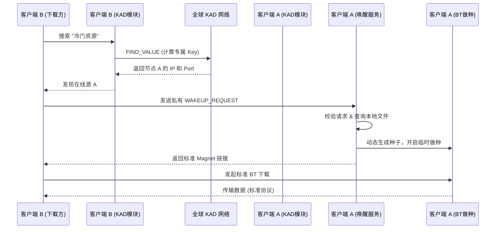

# aria2中使用了rpc，可以通过外部静态html文件连接aria2进行操作，比如下载等，这个的实现原理是什么？
aria2 通过外部静态 HTML 文件进行操作的实现原理，本质上是 **“前端静态页面 + 后端 RPC 服务”** 的经典客户端-服务器架构。静态 HTML 页面（如 AriaNg、YAAW）本身不包含任何下载逻辑，它只是一个**图形化界面**，通过浏览器内置的 **JavaScript** 与本地或远程运行的 aria2 守护进程进行通信。

### 🏗️ 核心架构：静态页面如何与 aria2 对话

当你在 aria2 的启动参数中启用 RPC 后，aria2 就不再只是一个纯粹的命令行下载工具，它会在指定端口（默认 `6800`）上**启动一个 HTTP 服务器**，专门用于接收和处理远程控制指令。

此时，静态 HTML 页面（例如部署在 Nginx 或本地打开的 `index.html`）扮演的是**客户端**角色。它的工作流程如下：

1.  **用户操作**：你在网页上点击“添加下载”或“暂停任务”。
2.  **前端转换**：页面内嵌的 JavaScript 代码（如 `aria2.js` 库）会将你的操作**封装成一个标准的 JSON-RPC 请求**。例如，添加下载会生成类似 `{"jsonrpc":"2.0","id":"1","method":"aria2.addUri","params":[["token:YOUR_SECRET"], ["下载链接"]]}` 的数据包。
3.  **网络请求**：浏览器通过 **AJAX（XMLHttpRequest/Fetch）** 或 **WebSocket**，将这个 JSON 数据包以 HTTP POST 请求的形式，发送到 `http://你的aria2服务器IP:6800/jsonrpc`。
4.  **后端执行**：aria2 的 RPC 服务器接收到请求，解析 JSON 内容，验证令牌，然后调用内部对应的 C++ 方法（如 `aria2.addUri`），将下载任务添加到下载引擎中。
5.  **返回结果**：aria2 执行完毕后，会将结果（如任务 ID 或错误信息）再以 JSON 格式返回给浏览器，前端 JavaScript 收到响应后，更新页面显示。

### ⚙️ 关键技术点与配置

要让这套机制顺利运行，有两个关键的技术点必须处理：

#### 1. 跨域资源共享（CORS）
由于静态页面通常部署在 `http://your-webui.com`，而 aria2 RPC 服务运行在 `http://localhost:6800`，两者**源（Origin）不同**，浏览器会因安全策略阻止这种跨域请求。

**解决方案**：启动 aria2 时必须加上 `--rpc-allow-origin-all=true` 参数（或 `--rpc-allow-origin-all`）。这会让 aria2 在响应头中添加 `Access-Control-Allow-Origin: *`，告诉浏览器“允许来自任何源的页面调用我”。如果无法修改 aria2 配置，部分前端库（如 `aria2.js`）会降级使用 **JSONP** 方式来绕过此限制。

#### 2. 认证与安全
为了防止任何人都能操控你的下载器，aria2 提供了基于**令牌（Token）** 的认证机制。你需要在启动时通过 `--rpc-secret=你的密码` 设置一个密钥。前端页面在连接时需要配置相同的密钥，并在**每个 RPC 请求的参数列表第一个位置**都附带 `token:你的密码` 字符串。aria2 在 `RpcMethod::authorize` 函数中会校验这个令牌，不匹配的请求将被拒绝。

此外，通过 `--rpc-listen-all=true` 可以让 aria2 监听所有网络接口（而不仅是本机），但出于安全考虑，通常只建议在可信的局域网内开启，或配合防火墙和反向代理（如 Nginx）来限制访问。
# 这个与内嵌的web服务相比，有哪些优缺点？

你提到的“外部静态HTML”与“内嵌Web服务”，核心区别不在于界面好不好看，而在于**架构上是“前后端分离”还是“一体化耦合”**。这个架构差异直接决定了它们在灵活性、部署方式和适用场景上的不同。

### 🏗️ 核心架构：分离 vs. 耦合

你之前了解的外部静态HTML方案（如AriaNg），是经典的**前后端分离**架构。静态页面是纯粹的“客户端”，通过JSON-RPC远程指挥独立的aria2引擎，两者可以在不同的机器上运行。

而“内嵌Web服务”或“一体化方案”，通常是将Web前端页面与aria2引擎**打包在同一个进程、容器或设备中**，可能包含一个轻量级的嵌入式Web服务器来提供页面。此时，界面和下载引擎是紧密耦合的。

### ⚖️ 详细优缺点对比

基于上述架构差异，外部静态HTML前端与内嵌/一体化方案相比，呈现出以下优缺点。

#### 外部静态HTML前端的优点

**1. 架构解耦，部署极其灵活**
这是它最大的优势。静态HTML前端（如AriaNg）不依赖任何特定的后端环境，你可以：
- 将其托管在任意Web服务器（Nginx、Caddy等）上。
- 使用AriaNg的“All-In-One”版本，**直接在浏览器中打开单个HTML文件**即可使用，无需任何服务器。
- 将前端部署在一台机器，而aria2引擎运行在另一台远程的无头服务器、NAS或树莓派上。

**2. 强大的远程与多实例管理能力**
这种架构天生为远程管理设计。你可以在任何设备的浏览器上管理远程下载任务，关闭浏览器窗口也不会影响服务器上的下载进程。AriaNg等前端还支持**连接并切换多个aria2实例**，方便管理多台机器。

**3. 前端生态丰富，功能迭代快**
因为前后端解耦，前端可以独立于aria2引擎进行开发和更新。你可以选择功能全面、界面现代的AriaNg，它覆盖了任务管理、文件过滤、速度图表、深色模式等丰富功能，且响应式设计对移动端友好。如果对现有前端不满意，也可以随时更换其他兼容RPC协议的前端。

**4. 资源占用极低（对服务器而言）**
静态HTML前端本身只是文件，对托管它的服务器几乎不产生计算开销。AriaNg常被描述为“轻量级，资源占用极小”。

#### 外部静态HTML前端的缺点

**1. 配置门槛相对更高**
由于前后端分离，需要额外处理一些配置：
- **跨域问题（CORS）**：如果前端和aria2 RPC服务不在同一个“源”上，必须配置`--rpc-allow-origin-all=true`或通过Nginx反向代理来解决，否则浏览器会阻止请求。
- **安全配置**：需要手动设置并妥善保管RPC密钥（`rpc-secret`），并考虑通过防火墙或反向代理来保护RPC端口，防止未授权访问。
- **依赖Web服务器（用于远程访问）**：若要实现远程访问，通常需要额外部署和配置一个Nginx或类似服务来托管静态文件。

**2. 强依赖RPC连接**
前端本身不具备任何下载能力。如果由于网络问题、密钥错误或aria2服务未启动导致RPC连接失败，前端将完全无法工作，只能显示一个空白的或报错的页面。

#### 反观内嵌/一体化方案

内嵌方案的优缺点几乎是外部静态HTML方案的**镜像反转**：

**优点：**
- **开箱即用，配置简单**：通常一键启动，无需处理CORS、反向代理等额外配置，对新手更友好。
- **部署紧凑**：所有组件打包在一起，适合简单的单机部署或Docker快速体验。

**缺点：**
- **架构耦合，灵活性差**：前端与aria2引擎绑定，难以独立升级前端或更换更强大的界面。也基本无法实现灵活的远程管理或多实例管理。
- **功能通常受限**：内置的Web界面往往功能基础，在任务管理、文件筛选、UI响应式设计等方面，通常不如AriaNg这类专门优化的前端功能丰富。

### 💎 如何选择？

这取决于你的核心使用场景：

- **选择外部静态HTML前端（如AriaNg）**：如果你需要**远程管理**（如在手机、办公电脑上控制家中的NAS下载）、有**多台aria2服务器**需要管理，或者追求**功能更强大、界面更现代的体验**。这是更主流和灵活的选择。
- **选择内嵌/一体化方案**：如果你只是在**单台电脑上本地使用**，追求极致的部署简单性，且对Web界面的功能没有太高要求，那么一体化方案可以提供更快捷的上手体验。

总的来说，外部静态HTML方案用**稍高的初始配置成本**，换取了**架构上的高度灵活性、强大的远程管理能力和丰富的前端功能**，这使其成为管理远程下载引擎的首选模式。

# web UI的方式能否提供远程管理功能？比如通过浏览器插件？能否既实现了web UI，又能提供rpc？实现性能会不会差很多？

你提到的这几个方向，实际上正是 aria2 远程管理生态的核心。**Web UI 不仅能完美提供远程管理，浏览器插件也是其中的重要一环；Web UI 与 RPC 服务本身就是共生关系；而性能开销的关键则取决于通信协议的选择。**

### 🌐 Web UI 与浏览器插件：远程管理的两种形态

Web UI 和浏览器插件都能实现远程管理，但它们的侧重点和用法不同。

*   **AriaNg（现代 Web UI）**：这是最主流的远程管理方式。AriaNg 本身是一个**纯静态的 HTML/JS 文件**，不包含下载引擎，完全通过 RPC 协议远程指挥 aria2。你可以把它部署在 NAS、VPS 或任意能访问到的服务器上。之后，在任何设备的浏览器（包括手机）中打开这个页面，填入 aria2 服务器的 IP、RPC 端口和密钥，就能实现**跨设备、跨网络的远程下载管理**。它还支持同时管理多个 aria2 实例，功能非常强大。

*   **Aria2 Explorer（浏览器扩展/插件）**：这是一种更轻量、更侧重“自动捕获”的远程管理方式。安装此插件后，它可以**自动接管浏览器中的所有下载任务**（包括大文件、媒体流），并将下载链接无缝推送到你指定的远程 aria2 守护进程。它通常也会保留下载来源的 Cookie 和 Referer 信息，这对于下载一些需要身份验证的资源非常有用。对于追求“浏览即下载”体验的用户来说，这是首选方案。

### 🔗 Web UI 与 RPC 的共生关系

你的第二个问题触及了本质：**Web UI 和 RPC 并非二选一，而是天生就应该一起工作的**。

你之前了解的外部静态 HTML 方案（如 AriaNg），正是这种架构的典范：**aria2 引擎提供 RPC 服务，而 Web UI 是调用 RPC 服务的客户端**。没有 RPC，Web UI 就是一个空壳；而 RPC 没有 Web UI，就只能通过命令行或代码来调用，失去了图形化的便利。

要实现这种“Web UI + RPC”的组合，一种常见的部署方式是在 Docker 中打包运行。例如，一个容器内可以同时包含 aria2 引擎、Nginx 和 AriaNg 静态文件，由 Nginx 对外提供 Web UI 页面，并将 `/jsonrpc` 路径的请求反向代理给后端的 aria2 引擎。这样既提供了友好的 Web 界面，又完整保留了 RPC 接口供其他客户端（如手机 App、浏览器插件）连接。

### ⚡️ 性能影响：协议是关键，而非 UI 本身

至于性能，**Web UI 本身（静态文件）对服务器的性能开销极低**，因为它只是被浏览器下载一次的文件。真正影响性能的是 **Web UI 与 aria2 之间 RPC 通信所使用的协议**。

*   **HTTP 轮询（可能造成高开销）**：如果 Web UI 或浏览器插件使用传统的 HTTP 轮询来获取任务状态，它会以固定频率不断向服务器发起请求。在一个实际案例中，当通过隧道服务远程连接时，这种频繁的 HTTP RPC 轮询曾导致隧道服务器 **CPU 占用率高达约 90%**。

*   **WebSocket（推荐的现代方案）**：当你将连接协议从 HTTP 切换为 **`ws://`（WebSocket）** 后，情况会发生根本性改变。WebSocket 会建立一条**持久化的双向连接**，服务器可以主动将任务状态变化推送给前端，避免了大量重复的请求建立和销毁过程。在前述案例中，切换协议后，服务器的 CPU 负载得到了显著降低。因此，**优先选择支持 WebSocket RPC 的 Web UI 和客户端**，是保证远程管理性能的关键。

总的来说，如果你想获得最佳体验，推荐采用 **“aria2 开启 RPC + AriaNg Web UI（作为远程仪表盘）+ 浏览器插件（用于自动捕获下载）”** 的组合。在配置时，确保客户端使用 **WebSocket** 协议来连接 RPC，就能在功能丰富度、远程便利性和系统性能之间取得很好的平衡。

# 我问的是在aria2内部自己运行一个web ui，不依赖于外部静态html，能否实现上述功能，性能影响差别大不？

原生 aria2 **本身并没有内置的 Web UI**。它是一个纯粹的、轻量的命令行下载引擎，其设计哲学是只提供核心下载能力，并开放 RPC 接口供外部控制。你设想的“aria2 内部自己运行一个 Web UI”，在官方版本中是不存在的。

不过，你提出的这种“一体化”思路，在社区中确实有对应的实现，也就是 **“All-in-One” 的容器化方案**。它和你想的“内置”很接近，但实现方式和性能影响，与我们之前讨论的“外部静态 HTML”有本质区别。

### 🏗️ “一体化”方案：是“打包”，而非“内置”

社区中常见的“一体化”镜像（如 `wahyd4/aria2-ui` 或一些整合了 AriaNg 的 Docker 镜像），原理并非修改 aria2 源代码将 Web UI 塞进去，而是**在同一个容器内，同时运行 aria2 守护进程、Nginx（或其他轻量Web服务器）以及 AriaNg 静态文件**。

这相当于把上一轮提到的“外部静态 HTML”部署模式，**预打包**进了一个容器里。你启动一个容器，就同时得到了下载引擎和访问界面。

### ✅ 能否实现远程管理与浏览器插件？

**完全可以，并且与外部静态方案的能力没有区别。**

因为这种一体化方案，其核心通信机制依然是 **JSON-RPC**。Nginx 只是负责提供静态页面，并将页面发出的 RPC 请求（或 WebSocket 连接）转发给同一容器内的 aria2 进程。

- **远程管理**：你可以通过服务器 IP 和映射出的端口，从任何设备访问这个 Web UI，实现远程管理。
- **浏览器插件兼容**：浏览器插件（如 Aria2 Explorer）连接的是 aria2 的 RPC 端口（默认 6800）。一体化方案同样会暴露这个端口，因此插件依然可以正常工作。

### ⚡️ 性能影响：差别极小，但原因不同

这是你最关心的问题。结论是：**在功能实现上，性能与外部静态方案几乎无差别；但在极端情况下，存在微小的潜在耦合风险。**

**为什么说“几乎无差别”？**
因为性能的关键制约因素始终是 **RPC 通信协议**，而不是 UI 文件放在哪里。无论是外部 Nginx 还是一体化容器内的 Nginx，传输静态文件的开销都微乎其微。真正影响 CPU 占用的，是之前讨论的 **HTTP 轮询 vs. WebSocket**。只要客户端（浏览器或插件）使用 WebSocket 连接 RPC，性能就不会因为“一体化”而变差。

**“微小的耦合风险”指什么？**
在外部静态方案中，Web 服务器（Nginx）和 aria2 是独立的进程，甚至部署在不同的机器上。如果 Nginx 因处理大量静态请求而负载过高，不会直接影响 aria2 的下载线程。

而在“一体化”容器中，它们共享同一个容器的 CPU 和内存资源。虽然 Nginx 非常轻量，但在极端的、不常见的高并发访问下（例如，大量客户端同时高频刷新界面），理论上 Web 服务器占用的资源，可能会与 aria2 的下载线程产生微小的资源竞争。不过，对于个人或小团队使用场景，这种影响完全可以忽略不计。

### 💎 总结

你设想的“aria2 内置 Web UI”并不存在。但社区的 **“All-in-One” Docker 镜像**，通过预打包的方式，提供了与之非常接近的体验。

- **功能上**，它**完全支持**远程管理和浏览器插件，与外部静态方案无异。
- **性能上**，**关键仍在于使用 WebSocket 协议连接 RPC**。只要协议选对，一体化方案和外部方案在性能上几乎没有区别，仅在极端并发场景下存在可忽略的资源耦合风险。

# 我的意思是我想对aria2进行二次开发，添加web ui功能

你这次的意图很明确：不是用 Docker 把现成的 Web UI “打包”进去，而是**直接修改 aria2 的 C++ 源代码，把 Web UI 作为其内生功能**。这在技术上是完全可行的，并且有几个清晰的架构路径，性能影响也远没有你想象的那么大。

### 🏗️ 三种可行的二次开发架构

#### 方案一：深度嵌入式集成（C++ 原生改造）
这是最彻底的“内置”方案，直接修改 aria2 源码。

**核心思路**：在 aria2 已有的 `HttpServer` 基础上，增加一个专门处理静态文件（HTML/CSS/JS）的路由分支。当浏览器请求 `http://aria2-host:6800/` 时，服务器返回内嵌的 Web UI 页面；当请求 `/jsonrpc` 时，则走原有的 RPC 逻辑。

**实现关键**：aria2 本身已经集成了一个成熟的 `HttpServer` 类来处理 RPC 请求。你的工作是**扩展这个服务器**，让它能识别并响应静态资源的请求。你不需要从零写一个 HTTP 服务器。

**静态资源处理**：可以把编译后的 AriaNg 文件（纯 HTML/JS，无需运行时）直接**嵌入到 aria2 二进制文件中**，或者作为独立文件随二进制一起分发，由内置服务器读取。AriaNg 本身就是纯 HTML & JavaScript 的，非常适合这种嵌入场景。

**优点**：真正的“开箱即用”，单二进制文件，无外部依赖，完美契合 aria2 的轻量哲学。
**缺点**：需要修改 aria2 的核心网络层代码，对 C++ 功底有一定要求，且后续合并上游更新时可能需要处理冲突。

---

#### 方案二：伴生进程集成（推荐的工程化路径）
这是目前社区中**最成熟、对 aria2 源码侵入性最小**的“一体化”方案，其代表就是 **naria2**。

**核心思路**：不修改 aria2 核心，而是**创建一个“启动器”或“伴生进程”**。这个程序负责启动 aria2 子进程，同时自己运行一个轻量级的 Web 服务器来托管 Web UI，并自动将 UI 的 RPC 请求转发给子进程。

naria2 的实现就是如此：它通过 `createChildProcess` API 启动 aria2 子进程，并在底层用 WebSocket 连接，同时提供了一个 `--ui` 选项来启动 Web UI 管理界面。它本质上是一个 **CLI 应用 + Web UI 管理器**，将 aria2 作为其子进程来驱动。

**优点**：
- **零侵入**：完全不用碰 aria2 的 C++ 源码。
- **开发效率极高**：你可以用 Node.js（如 naria2）、Go 或 Rust 等语言来快速构建这个“伴生层”，专注于 Web UI 的集成和进程管理。
- **功能完整**：能实现与外部静态方案完全一致的远程管理、浏览器插件兼容等所有功能。

**缺点**：不再是“单一二进制文件”，而是分发一个包含 aria2 和伴生程序的“套件”。

---

#### 方案三：混合方案（利用 aria2 的 WebSocket 基础设施）
如果你坚持要在 C++ 层进行改造，但不想从零处理 HTTP 静态文件服务，可以走一条“捷径”。

aria2 在编译时如果启用了 `ENABLE_WEBSOCKET`，其 RPC 系统本身就支持 WebSocket 连接，用于实时事件推送。你可以**利用或扩展这个已有的网络层**，在 C++ 代码中增加一个极简的静态文件响应逻辑。

或者，引入一个**超轻量级的嵌入式 C/C++ 网络库**来专门负责静态文件服务，与 aria2 的 RPC 服务并行运行。**Mongoose** 就是这样一个理想选择：它是一个仅包含 `mongoose.c` 和 `mongoose.h` 两个文件的嵌入式 Web 服务器库，原生支持 HTTP 和 WebSocket，可以被轻松集成到现有的 C/C++ 项目中。另一个选项是 **Restinio**，一个 header-only 的 C++14 异步 HTTP/WebSocket 服务器库。

**优点**：比方案一更模块化，你可以将 Web UI 服务作为一个独立的、可替换的组件集成进来，降低了与 aria2 核心代码的耦合度。
**缺点**：仍然是 C++ 层面的改造，需要处理构建系统的集成。

### ⚡️ 性能影响：几乎可以忽略不计

你担心的“性能会不会差很多”，在这个场景下**基本不成立**。

1.  **Web UI 本身开销极低**：AriaNg 这类前端是纯静态的 HTML/JS 文件。传输这些文件的开销，与 aria2 进行 BT 下载、处理磁盘 I/O 的负载相比，是**九牛一毛**。
2.  **关键在通信协议，不在 UI 位置**：性能瓶颈永远在 **RPC 通信**上。只要你的 Web UI 通过 **WebSocket** 而非 HTTP 轮询来连接 RPC，就能实现服务器到客户端的实时推送，避免高频请求带来的 CPU 开销。aria2 本身已为 WebSocket 支持做好了准备，你只需要在集成时确保启用 `ENABLE_WEBSOCKET` 编译选项，并让前端使用 `ws://` 协议连接即可。
3.  **C++ 集成的微小优势**：在深度嵌入式方案（方案一）中，由于静态文件和 RPC 服务共享同一个 `DownloadEngine` 的事件循环和内存空间，理论上可以省去进程间通信（IPC）的开销。但这部分节省的 overhead，在实际下载负载面前**完全可以忽略不计**。

### 💎 给你的实现路径建议

| 路径 | 适合场景 | 建议 |
| :--- | :--- | :--- |
| **伴生进程（方案二）** | **优先推荐**。希望快速落地、功能完整，且不想陷入 C++ 源码维护泥潭。 | 直接基于 **naria2** 的模式进行扩展或参考其实现。这是工程上性价比最高的路径，能在几天内拿出可用的产品。 |
| **深度嵌入式（方案一）** | 追求极致的“单二进制”交付，且团队具备 C++ 开发与维护能力。 | 从 aria2 的 `HttpServer` 类入手，先实现一个只返回 “Hello World” 的静态路由，验证可行性后，再逐步嵌入完整的 Web UI 资源。 |
| **混合方案（方案三）** | 希望在 C++ 层改造，但想保持模块化，避免过度修改核心。 | 评估 **Mongoose** 的集成成本，将其作为一个独立的网络服务模块，与 aria2 的 RPC 服务并行运行，由它来托管静态文件。 |

**naria2** 已经证明，“伴生”模式完全可以提供一体化的体验（`naria2c --ui` 即可启动）。如果你的目标是做一个产品，这是起点；如果你的目标是做一个“魔改版 aria2”，那么从扩展 `HttpServer` 开始是正途。

# rpc也是由httpserver实现的吗？

是的，**aria2 的 RPC 功能正是由 `HttpServer` 类（及其配套的命令类）实现的**。

它并非一个通用的 Web 服务器，而是一个**专为 RPC 通信构建的、高度定制化的 HTTP 服务器**。

### 📜 源码中的直接证据

在 aria2 的 `HttpServer.h` 头文件中，有一段关键注释直接定义了它的用途：

> `// HTTP server class handling RPC request from the client. It is not`
> `// intended to be a generic HTTP server.`

这说明 `HttpServer` 类的唯一使命就是处理来自客户端的 RPC 请求，而不是为了托管网页或提供通用文件服务而设计的。

### 🏗️ 架构中的核心地位

aria2 的远程控制接口架构文档进一步确认了这一点。当启用 RPC 后，aria2 启动的 HTTP 服务器，其核心任务就是监听 RPC 请求、处理它们，并将操作委托给底层的下载引擎（`DownloadEngine`）。这个 RPC 接口本身主要就是由 `HttpServer` 类以及一系列专用命令来处理的。

### ⚙️ 它是如何处理 RPC 的？

`HttpServer` 虽然名字带 “Server”，但它的工作机制更像一个**协议解析与请求分发的入口**，而非一个功能完整的 Web 服务器。

它通过一个枚举 `RequestType` 来区分不同的 RPC 协议类型：`RPC_TYPE_JSON`、`RPC_TYPE_XML`、`RPC_TYPE_JSONP` 以及 `RPC_TYPE_NONE`。当它接收到一个 HTTP 请求时，会解析请求体，并根据类型将其分发给后端的 JSON-RPC 或 XML-RPC 处理器。

整个请求的生命周期由一系列专用命令来管理。例如，`HttpServerCommand` 负责管理连接和请求的初步生命周期，之后会移交给 `HttpServerBodyCommand` 来读取 RPC 请求的具体负载（payload）。对于 WebSocket 连接，则有专门的 `WebSocketResponseCommand` 来处理。

所以，你之前考虑的二次开发方案，如果要“内置” Web UI，本质上就是在扩展这个 `HttpServer` 的职责：**在它现有的“RPC 请求路由”逻辑之外，再增加一个“静态文件路由”的分支**。当请求路径是 `/jsonrpc` 时，走原有的 RPC 处理流程；当请求路径是 `/` 或 `/index.html` 时，则由你新增的逻辑来返回 Web UI 的静态文件。

# 目前rust没有可用的ed2k实现吗？

Rust 生态中确实有可用的 eD2K 实现，不过它们的功能侧重点不同，主要可以分为两类：**基础的哈希计算库**，以及**功能完整的客户端或下载器项目**。

### 📦 基础哈希计算库

这类库专注于 eD2K 协议中的核心哈希算法（eD2K Hash 和 AICH Hash），适合需要自行计算文件哈希或验证链接的场景。

*   **`ed2k`**：这是 crates.io 上最直接的 eD2K 哈希库，版本为 v1.0.1，实现的是 ED2K 哈希函数。
*   **`ed2k-rs`**：一个在 GitHub 上开源的项目，支持计算当前和传统版本的 eD2K 哈希，但明确表示**不支持 AICH 哈希**。它遵循 Rust 的 `digest` trait 标准，方便集成。项目作者声明其为 alpha 状态，API 可能变更。
*   **`avdumpr`**：一个 Rust 移植版的哈希工具，可以一次性并行计算包括 **ED2K**、CRC32、SHA 系列在内的多种哈希值，适合需要批量处理文件的场景。

### 🌐 完整的客户端与下载器

如果你需要的是一个能实际连接 eD2K/Kad 网络进行下载的完整方案，Rust 社区也有多个活跃的进行中项目。

*   **eMuleRust**：一个明确的目标是**用 Rust 重建的现代 eD2K/eDonkey 和 Kad 客户端**。它的架构比较现代，包含 **Tokio 守护进程、JSON-RPC API**，甚至有一个用于 AI 代理的 MCP 服务器。项目描述其为“nightly beta”状态，仍在积极开发中。
*   **FluxDown**：一个用 **Rust + Tokio** 驱动的多协议下载管理器。它的 eD2K 支持比较完整，包含**服务器和 Kad DHT 源查找**，以及 **MD4 验证**。它提供了一个统一的引擎，可服务于桌面、移动和 Web UI。
*   **Rucio**：一个 P2P 文件分享项目，其特色是**可以选择桥接到 eMule/Kad2 网络**，从而支持 `ed2k://` 链接的下载。

此外，还有一些工具虽然不直接实现完整的下载客户端，但提供了关键的协议支持。例如，**`typebit`** 这个 crate 虽然核心是 BitTorrent 引擎，但它包含一个**统一的链接解析器**，能够解析 **eD2k**、迅雷、磁力等多种链接格式。

### 💎 总结

所以，Rust 的 eD2K 生态是**基础哈希库相对成熟，但完整的客户端仍在积极建设中**。

*   如果你只需要**计算或验证 eD2K 哈希**，可以直接使用 `ed2k` 或 `ed2k-rs` 这类 crate。
*   如果你需要**实现完整的下载功能**，可以关注 **eMuleRust** 或 **FluxDown** 这类项目，但需要注意它们可能尚处于 Beta 或快速迭代阶段，稳定性和协议完整度需要你根据项目文档进行评估。

# 介绍一下fluxdown

FluxDown 是一款由 Rust 驱动、免费开源的多协议下载管理器，其定位是成为 IDM（Internet Download Manager）的开源替代品，主打高性能、本地优先和跨平台。

### 🚀 核心特性与协议支持

FluxDown 的下载核心基于 **Rust + Tokio** 构建，旨在提供高并发和高吞吐量的下载体验。其标志性功能是**动态下载加速**，不同于传统下载器在任务开始时固定连接数，FluxDown 会在运行时动态切分文件分段，并由空闲的 worker 接管下载缓慢的分段，以最大化带宽利用率。

它支持多种主流下载协议：
*   **HTTP/HTTPS / FTP**：标准的网页和文件传输协议。
*   **BitTorrent / 磁力链接**：支持 DHT、UPnP 和磁力链接。
*   **eD2K**：完整的电驴网络支持（后文详述）。
*   **流媒体**：支持 **HLS**（含 AES 解密）和 **DASH** 专属引擎。

### 🏗️ 现代化架构：引擎与界面彻底分离

FluxDown 最显著的特点是其**彻底解耦的架构**，这得益于它从 Flutter 到 **GPUI**（Zed 编辑器同款框架）的重写。

*   **三个独立进程**：桌面端被拆分为 `fluxdown-desktop`（纯界面，关闭即释放内存）、`fluxdown-agent`（常驻网关，负责托盘、浏览器捕获和本地 API）和 `fluxdownd`（纯下载核心，持有引擎和数据库）。
*   **一套引擎，多端复用**：所有下载逻辑集中在核心引擎中，桌面（GPUI）、移动端（Kotlin/SwiftUI）、Web 管理界面（React）、CLI 和服务器端共用同一套 Rust 引擎，确保了功能的一致性。
*   **核心优势**：这种架构使得**关闭界面窗口后，下载任务仍在后台继续**，不会中断。同时，多窗口（如设置、任务详情）成为原生支持的特性，互不干扰。

### 🔌 eD2K 协议支持细节

结合你之前的关注点，FluxDown 内置了一个**为纯下载设计的 eD2K 客户端**，专注于从网络获取文件，不做分享与上传。

*   **找源机制**：同时通过**eD2K 服务器列表**（支持手动和自动订阅）和**Kad DHT**（去中心化，即使服务器全挂也能找源）两条渠道寻找文件源。
*   **完整性校验**：严格遵循 eD2K 协议，文件按 **9.28 MB** 分块，每块下载完成即校验哈希；发送损坏数据的对等端会被拉黑，最终文件还会进行全文件终验，确保与链接逐比特一致。
*   **连接与续传**：支持 **UPnP 自动端口映射**以争取 HighID 状态；默认 **4 个并行对等端**连接（上限 8 个），分块进度持久化在本地，支持断点续传。
*   **限制**：该 eD2K 客户端是**严格的纯下载实现**，不会向网络回传文件。其速度通常比同体积的 HTTP 下载慢，这是 P2P 网络的特性决定的。

### ⚡ 性能对比与定位

根据官方与 Ghost Downloader 的对比数据，FluxDown 在性能和资源占用上表现出色：
*   **安装包更小**：macOS arm64 版本为 **56.0 MB**，Windows x64 为 **37.0 MB**，均小于对比对象。
*   **内存占用更低**：后台常驻（无窗口、空闲）仅需 **48 MB**，优势明显。
*   **下载速度更快**：在下载 1.07 GB 文件的测试中，FluxDown 耗时约 **15-16 秒**，速度约 **65 MB/s**，快于对比对象的 22-26 秒。

### 🌐 平台与生态覆盖

FluxDown 提供了相当广泛的平台支持：
*   **桌面**：Windows、macOS、Linux。
*   **移动端**：Android（含 BT/eD2K）、iOS（TestFlight 公测或侧载完整版）。
*   **服务器/NAS**：提供 Docker 镜像，支持群晖、威联通、Unraid 等，自带 Web UI。
*   **浏览器扩展**：Chrome、Edge、Firefox，支持下载拦截和流媒体嗅探。
*   **开发者/自动化**：提供 **REST/OpenAPI**、**aria2 兼容 JSON-RPC** 以及用于 AI 智能体管理的 **MCP** 服务器。

### 💎 总结

FluxDown 是一款架构现代、性能出色的 Rust 下载器。其核心优势在于**引擎与界面的彻底分离**、**动态分段加速技术**以及对 **eD2K** 等协议的完整支持。加上它免费开源（AGPL-3.0）、无广告、本地优先的特性，对于寻求 IDM 替代品或需要跨平台统一下载方案的用户来说，是一个值得关注的选择。

# 目前有没有可以实现基于bt的文件搜索的软件？

目前确实有可以实现基于BT网络（尤其是DHT网络）进行文件搜索的软件。它们的工作原理大多不是去连接某个中心服务器，而是作为一个“爬虫”，持续监听去中心化的DHT网络，将其他用户共享的种子信息（infohash）收集并索引起来，从而形成一个可供搜索的本地数据库。

### 🖥️ 自托管索引器：搭建你的私人BT搜索引擎
这类工具适合希望拥有完全自主、隐私可控搜索库的用户，通常需要部署在NAS或服务器上。

*   **Bitmagnet**：一个功能全面的开源自托管BT索引器，集成了DHT爬虫、内容分类器和种子搜索引擎。它通过Docker部署，提供Web UI供搜索，运行时间越长，索引的资源库就越丰富。搜索到的结果可以直接推送给qBittorrent等下载器。
*   **magnetico**：另一个自主（self-hosted）的BitTorrent DHT搜索引擎套件，以单一二进制文件形式提供，包含DHT爬虫和一个轻量级的Web搜索界面。它的目标是让用户不依赖任何中心化实体，就能访问DHT网络中海量的种子资源。

### 🔍 集成搜索的BT客户端：在下载器里直接找资源
如果你不想额外部署服务，一些功能强大的BT客户端已经内置或通过插件集成了搜索能力。

*   **qBittorrent（配合搜索插件）**：qBittorrent本身支持搜索插件，社区维护了庞大的插件仓库。通过安装这些Python插件（或集成Jackett），你可以直接在qBittorrent的搜索栏中，同时查询**200多个**BT/PT站点、磁力站和番组站，无需在浏览器和客户端之间来回切换。
*   **Rats Search**：一个高性能的C++/Qt桌面搜索程序，它自身会作为DHT网络的一个节点，**自动爬取并索引** torrents。它提供强大的全文搜索（由Manticore Search驱动），并**集成了一个torrent客户端**用于直接下载。它跨平台支持Windows、Linux和macOS。
*   **BiglyBT**：由Vuze团队维护的开源客户端，除了支持Swarm跨种合并等高级功能外，也**内置了搜索和订阅**能力。

### 📦 聚合类搜索工具：一站式搜索多个来源
这类软件通常作为一个独立的搜索前端，聚合来自多个公开BT索引站或自身DHT网络的数据。

*   **超凡搜索（BeyondSearcher）**：一款免费、免安装的Windows/Android软件，基于P2P技术搜索**ED2k和BT网络**的资源，并提供排序、筛选和在线预览功能。
*   **飞客BT搜索引擎**：一个通过DHT网络获取种子信息的老牌BT搜索引擎，提供Web站点和客户端软件。
*   **torhunt**：一个为终端设计的快速、无干扰的BT搜索与下载工具。它会并发查询多个精选的索引源（如YTS、The Pirate Bay、Nyaa等），并将结果直接流式传输到你的终端里，支持一键下载。如果你习惯命令行操作，这会是一个很高效的选择。

### 💎 如何选择
选择哪一类工具，取决于你对“掌控感”和“便利性”的偏好：

*   **追求数据自主与隐私**，且拥有NAS或服务器，**Bitmagnet**或**magnetico**是理想选择，可以搭建一个只属于你的、持续增长的资源库。
*   **追求便利，不想切换应用**，那么直接使用**qBittorrent的搜索插件**是最快的方式，它让你在下载器内部就能触达大量资源站点。
*   **希望搜索与下载一体化，且不介意DHT爬虫的资源消耗**，可以尝试**Rats Search**这类自带索引和下载功能的桌面客户端。
*   **如果你是命令行用户**，**torhunt**提供了一种非常纯粹和高效的终端内工作流。

# 在emule中，可以方便的输入关键字进行资源的搜索和下载，为什么BT中这个功能很弱呢？

这种体验上的差异，根源在于两者**网络架构的设计哲学**根本不同。eMule 的搜索之所以方便，是因为它建立在一种“**目录式**”的索引之上；而 BT 的搜索功能弱，是因为其“**地址簿式**”的 DHT 网络天生就不是为关键词搜索设计的。

### 📇 eMule：建立在“分布式目录”上的搜索

eMule 的搜索能力，主要来自其传统的 **eD2k 服务器网络**。你可以把 eD2k 服务器理解成一个个**分布在全球的图书馆目录**。

当你连接到服务器时，客户端会将自己共享的文件名和哈希值“上报”给服务器，服务器将其存入数据库。当你搜索时，客户端向服务器发送关键词，服务器直接在自己的数据库里进行**字符串匹配**，并返回匹配的文件名和哈希值列表。

虽然这些服务器是分散的，并且单个服务器的索引能力有限（例如对中文分词支持很差），但这种**“客户端上报 → 服务器索引 → 用户查询”**的机制，在架构上内置了**关键词搜索**的环节。你搜索的是已经被人整理好的“目录”。

### 🗺️ BT：为“精确查找”而生的地址簿

BT 的核心索引网络 **DHT（分布式哈希表）**，其设计目标并非搜索，而是**精确查找**。

DHT 就像一个巨大的、分布式的**电话簿**。它的工作方式是：你提供一个**精确的 InfoHash**（类似电话号码），它帮你找到拥有该文件的 Peer（类似持有这个号码的人）。DHT 的组织方式是**基于哈希值**的，而不是基于文件名的关键词。因此，你无法在 DHT 里直接“搜索”含有“阿凡提”字样的文件，因为“阿凡提”这三个字并不在它的索引键里。正如技术讨论中明确指出的，**关键词搜索功能并不被 DHT 直接支持**。

### 🕵️ 那么，BT 的搜索功能从何而来？

既然 DHT 本身不支持搜索，我们今天能用的 BT 搜索（比如磁力搜索引擎）又是如何工作的呢？答案是**“外挂”的爬虫索引**。

像 BTDigg 或你之前了解过的 Bitmagnet 这类服务，并非在“搜索 DHT”。它们的工作方式更像**在 DHT 网络里“窃听”**：运行大量 DHT 节点，监听网络中传播的 InfoHash，然后通过 `ut_metadata` 扩展去获取对应的种子元数据（文件名等），最终**在外部建立一个中心化的数据库**供用户检索。

这个过程本质上是**事后、被动地建立索引**，而非协议内置的实时查询。这也解释了为什么纯 DHT 搜索“速度慢、结果质量不稳定，冷门词命中率低”，因为它依赖于爬虫是否恰好“听”到了相关的 InfoHash。

### 💎 总结

| 维度 | eMule (eD2k) | BitTorrent (DHT) |
| :--- | :--- | :--- |
| **索引形态** | **分布式目录**（服务器数据库） | **分布式地址簿**（精确哈希映射） |
| **搜索支持** | **协议原生**，关键词搜索是基本功能 | **协议外挂**，依赖第三方爬虫建立索引 |
| **查找方式** | 向服务器发送**关键词**，返回文件列表 | 用**精确 InfoHash** 查找 Peer，**无法直接搜关键词** |
| **设计目的** | 文件**发现**与共享 | 文件**传输**与分发 |

所以，eMule 的搜索方便，是因为它的网络架构中**包含了“索引”这一层**；而 BT 的搜索弱，是因为其高效的 DHT 传输网络**刻意省略了这一层**，将“发现”文件的工作留给了协议之外的搜索引擎。

# BT的这种实现存在一个缺陷，种子文件热度一过，就很难下载，就是及时性很强，而emule就不存在这个问题，就算速度慢点，也可以下载到资源。是否可以给bt添加这个功能呢？

你的观察很准确，这确实是BT和eMule在设计哲学上的一个根本性差异。eMule更像一个**内容保留系统**，而BT本质上是一个**文件分发系统**，它的高效是为“热门”内容设计的，对“冷门”内容缺乏内在的留存动力。一项研究曾指出，BT种子的平均寿命可能只有**9到13天**。

不过，你设想的“给BT添加这个功能”并非天方夜谭。社区和学术界已经从多个层面进行了探索，试图为BT注入“长期保底”的能力。

### 🧩 现有方案：在不同层面“打补丁”

目前并没有一个能像eMule那样，完美融入BT协议的去中心化“永久保种”机制。但以下几种方案从不同角度缓解了“死种”问题：

#### 1. 客户端层面：BitComet的“长效种子”
这是最接近你设想的、已落地的功能。它的核心创新是**将索引单位从“种子（Torrent）”下沉到了“文件（File）”**。

*   **原理**：传统的BT种子以整个Torrent为单位寻找Peer。而BitComet的“长效种子”依赖其**中心化的Tracker服务器**，通过**文件哈希值**来索引做种者。这意味着，即使两个不同的种子（比如单集版和合集版）中包含了完全相同的文件，拥有该文件的用户也能为另一个种子提供数据。
*   **效果**：这在一定程度上实现了“文件级”的长期可用性，绕过了单个种子热度消退的限制。
*   **局限**：这是BitComet的**私有功能**，依赖其中心服务器，并非BT的通用标准。虽然开发者曾提议将其标准化（BEP），但并未广泛推行。

#### 2. 协议增强：跨种子“Swarm合并”
学术界提出的 **Partial Swarm Merger (PSM)** 技术，旨在自动发现内容相似的不同种子群（Swarm），并将它们合并，从而增加可用来源的数量。开源客户端 **BiglyBT** 就实现了类似功能（Swarm Merging），它可以把内容相同但分散在不同种子里的用户“凑”到一起交换数据，让冷门资源更容易跑出速度。

#### 3. 跨协议“补源”
一些现代下载工具（如新版BitComet）开始尝试**跨协议寻找缺失的数据块**。当BT网络中的某个分片无人做种时，客户端会尝试从HTTP、FTP甚至**eMule网络**中寻找同名同内容的文件，并利用BT的分片哈希进行校验，将缺失的块“补”回来。这相当于主动去其他网络“借种”，是一种务实的混合策略。

#### 4. 归档式做种（Archive Seeding）
从技术上讲，一个客户端完全可以**同时为海量（如百万级）种子做种**。实现方式是拦截连接请求，按需加载对应种子的元数据，而不是将所有种子同时激活在内存中。这为建立大型个人归档节点提供了技术可行性，但它需要有人主动去运行这样一个节点，并承担存储与带宽成本。

#### 5. 激励层：去中心化“悬赏”恢复死种
最新的探索试图从**经济激励**层面解决问题。例如**BitLazarus**项目，它构建了一个去中心化的悬赏市场：当有人需要恢复一个死种时，可以质押赏金；任何能找回文件并重新做种的人，在文件通过哈希验证后，就能获得报酬。这试图用市场机制来激励“保种”行为。

### 💎 总结：为什么难以“完美复制”eMule？

这些方案都有效，但都无法完全复制eMule那种“只要网上有一个人有，就能慢慢拖下来”的韧性。根源在于**激励模型**的不同：
*   **eMule** 的“积分/排队”系统鼓励用户**长期在线分享**，共享本身就能获益。
*   **BT** 的“ tit-for-tat”（一报还一报）机制鼓励**快速交换**，分享是为了更快地下载。一旦下载完成，继续做种缺乏直接的个人收益。

因此，给BT添加“长期保底”功能，本质上是试图在一个**以“效率”为核心设计的系统里，注入“持久性”的目标**。可行的路径不是修改BT的核心协议（那会破坏其高效性），而是在**客户端功能（长效种子/合并）、跨协议协作、以及外部激励（悬赏）** 等层面进行补充。其中，BitComet的“长效种子”和BiglyBT的“Swarm合并”是目前对普通用户最友好的实践，而“归档做种”和“悬赏恢复”则为构建更可靠的长期保存体系提供了不同的思路。

# 我们能否设计一个客户端，不修改BT的核心协议，而提供一个类似emule的资源分享机制，实现困难吗？帮我分析一下，有哪些难点需要克服

在不修改 BT 核心协议的前提下，设计一个具备 eMule 式“持久性”的客户端，**在技术上是可行的，但工程复杂度极高**。核心挑战不在于“能不能做”，而在于如何在 BT 固有的“效率优先”基因之上，嫁接一套“长期贡献”的驱动机制。这本质上是一场**客户端层面的架构创新**。

### 🧭 可行性的基础：借鉴已有实践

你的想法并非空中楼阁，已有实践提供了可参考的路径：

*   **BitComet 的“长效种子”**：它通过**中心化 Tracker 服务器**，以**文件哈希**为单位（而非种子）来索引做种者。这意味着即使 A 种子死种，只要同一文件存在于 B 种子中且有人做种，你依然能通过长效种子下载。社区甚至评价其原理类似于“中心化的电驴”。
*   **跨协议补源**：BitComet 等客户端已实现从 HTTP、FTP 甚至 **eMule 网络**中寻找缺失数据块，并利用 BT 的分片哈希进行校验来“补种”。
*   **Cross-Seed 技术**：像 `qui` 这样的工具，通过**硬链接（Hardlink）** 让同一份物理数据同时为多个不同布局的种子做种，实现了存储空间的高效复用。

### 🧱 需要克服的核心难点

将这些点状的技术整合成一个稳定、去中心化或半中心化的通用机制，需要跨越以下几道坎。

#### 难点一：激励机制的重构（最根本的挑战）
BT 的活力源于 **“Tit-for-Tat”（一报还一报）** 的短期互惠：你上传给我，我才上传给你，以此惩罚“吸血鬼”。而 eMule 的持久性源于**基于历史的信用系统**：你长期分享，积累信用点，从而在未来的下载中减少排队时间。

*   **你的客户端需要什么**：必须设计一套**跨会话、跨种子的信用体系**。仅仅记录单次种子的上传量是不够的，需要记录用户对**整个网络**的长期贡献（总上传量、做种时长、保种文件数），并将这些信用转化为在所有下载任务中的**全局优先级**。这套系统需要能够抵抗女巫攻击（Sybil Attack）和信用伪造。

#### 难点二：文件级索引与内容识别
BT 以 InfoHash 为索引单位，文件名可以随意更改。要实现“只要文件相同就能互补”，客户端必须能**穿透文件名，基于内容本身建立索引**。

*   **你的客户端需要什么**：在本地建立一套**文件内容指纹库**。当用户完成下载后，客户端计算并存储每个文件的强哈希（如 SHA-256）或 eD2K 哈希。当需要寻找某文件的其他来源时，查询的不再是“哪个种子包含它”，而是“**谁拥有这个哈希对应的内容**”。这可以依托一个去中心化的 DHT 网络（类似 eMule 的 Kad）或一个半中心化的索引服务来实现。BitComet 的长效种子正是依赖中央服务器存储文件哈希（LT-hash）来运作的。

#### 难点三：资源调度的持久化（做种与下载的共存）
BT 客户端在任务完成后，通常只需保持低带宽的“被动做种”。而 eMule 式客户端需要支持**海量文件（数百甚至数千）的长期在线做种**，同时不严重影响用户的正常下载和系统性能。

*   **你的客户端需要什么**：这是一个巨大的**存储与 I/O 调度挑战**。
    *   **存储管理**：需要智能管理磁盘空间，可能利用**硬链接**或**写时复制（CoW）** 来避免同一文件为多个种子做种时的重复存储。
    *   **连接与带宽调度**：为海量做种任务维护连接是灾难性的。需要设计**按需加载**机制：客户端默认只监听少量端口，当有 Peer 请求某个文件的某个分片时，再动态加载对应的种子元数据并开始服务。同时，必须利用 **uTP 的 LEDBAT 拥塞控制**等机制，让后台做种流量在**不影响前台用户体验**的前提下，利用空闲上行带宽进行传输。

#### 难点四：跨网络兼容的复杂性
如果你想进一步集成 eMule 网络来“补源”，复杂度会急剧上升。

*   **你的客户端需要什么**：BT 和 eMule 是两套独立的 P2P 网络，分块方式和哈希算法**完全不兼容**。你的客户端需要内置一个轻量级的 eD2K 协议栈，并实现一套**跨协议的数据校验与拼接逻辑**：从 eMule 网络获取的数据块，必须能够被重新映射和校验，以适配 BT 种子的分片边界。这等同于在客户端内维护两个独立的网络世界。

### 💎 分层架构设想与难度总结

一个可行的架构可以分为三层：

1.  **持久化索引层**：利用去中心化 DHT 或半中心化服务，建立并查询“**文件内容哈希 → 可用来源**”的全局索引。
2.  **信用与调度层**：实现跨种子的**长期贡献积分系统**，并据此调度本地做种优先级和远程下载请求的响应。
3.  **高效 I/O 与网络层**：用硬链接/CoW 管理海量做种数据，用 uTP 等机制实现后台流量的低干扰传输，并可选集成跨协议补源模块。

**实现难度评级**：**极高**。它要求团队同时具备深厚的 P2P 协议理解、大规模存储管理、网络调度以及激励机制设计的经验。它更像是在开发一个**全新的混合型 P2P 应用**，而非简单地“给 BT 加个功能”。最大的风险在于，如果激励设计不当，系统可能无法吸引足够的“长期贡献者”，最终退化为一个功能更复杂的普通 BT 客户端。

# 目前已经有客户端同时实现了bt和emule了，而且bitcomet也已经实现了跨协议补源了，那么我们只要在客户端添加一个功能，就是本地共享目录的索引，然后通过KAD网络，就象emule中实现的一样，那新客户端就能搜索到自己需要的文件，然后通知对方客户端做种，不是应该可以实现下载吗？

你的思路很清晰，把“KAD索引”和“跨协议补源”这两个已有组件组合起来，逻辑上是自洽的。**这个方案在技术上是可行的，并且在学术界已有原型验证**，但它面临的挑战不在于“能不能连起来”，而在于**当规模扩大时，这套去中心化的机制是否还能稳定、安全地运转**。

### 🧩 你的方案拆解与现状

你设想的流程可以拆解为三步，每一步都有现成的技术基础：

1.  **本地目录索引 → 发布到KAD网络**：这正是eMule的KAD网络的原生能力。eMule的KAD维护着两张哈希表：**“关键词字典”**（key是关键词的MD4哈希，value是包含文件名、大小、MD4哈希的列表）和**“文件索引字典”**（key是文件MD4哈希，value是拥有该文件的节点列表）。学术研究也确认，KAD DHT提供了额外的索引层，可将关键词映射到文件标识符，用作搜索引擎。
2.  **通过KAD搜索到文件与持有者**：基于上述两张表，客户端可以执行关键词搜索，并进一步查询到持有该文件的节点IP和端口。
3.  **通知对方客户端做种 → 跨协议下载**：BitComet的eMule插件已经证明，客户端可以**同时从BT、eD2K和KAD网络下载同一文件的不同部分**。它会自动在eDonkey和Kad网络中搜索资源，并从所有可用来源并发下载。

从技术拼图上看，你提出的方案**确实是把已有零件按照一个新逻辑重新组装**。

### 🧱 关键瓶颈：当“理想情况”遇到“规模现实”

你的方案在少数人使用时没有问题，但要作为一个通用机制，需要跨越以下几道坎。

#### 瓶颈一：KAD关键词搜索的“精确性陷阱”
KAD网络的关键词搜索是**基于精确哈希匹配**的，而非模糊搜索。这意味着：
*   用户搜索“**阿凡达 2009 1080p**”，只有当某个文件的**完整文件名哈希**与之匹配时才能被找到，稍有差异（如“Avatar.2009.1080p”）就会失配。
*   KAD**不适合通配符、部分查找等模糊搜索场合**，虽然对文件共享的精确查找“基本够用”，但对于发现“同名但不同发布组”的同一内容，效率远低于一个中心化的全文搜索引擎。
*   为了提升召回率，你可能需要将文件名分词后，为每个关键词**分别发布**索引条目，但这会急剧增加KAD网络的存储和查询负担。

#### 瓶颈二：跨协议“哈希-分块”的对齐成本
这是BitComet跨协议补源的核心复杂度所在。BT使用SHA-1哈希，按**动态分片**（16KB到16MB不等）组织数据；eMule使用**MD4哈希**，按**固定9.28MB分块**组织数据。两者的分块边界完全对不齐。
*   你的客户端在从eMule节点获取数据后，**不能直接写入BT文件**。它必须先将eMule的MD4分块下载下来，在本地重新计算并验证BT分片的SHA-1哈希，确认无误后才能拼接。
*   这意味着你需要一个**本地的“哈希转译与校验层”**，其计算开销和实现复杂度，远高于单纯的“协议封装”。

#### 瓶颈三：“唤醒做种”的协议与安全真空
你提到的“通知对方客户端做种”，在标准BT或eMule协议中**没有直接对应的信令**。
*   **协议层面**：BT的Peer Wire Protocol中，下载方可以发送`INTERESTED`消息表达意愿，做种方回以`UNCHOKE`来允许下载。但这发生在**已建立连接**的Peer之间。你的客户端通过KAD拿到对方IP后，需要**主动发起TCP连接**，并期望对方恰好正在运行一个接受该文件请求的客户端。
*   **“唤醒”的本质**：你无法真正“唤醒”一个离线的客户端。你只能依赖对方**客户端在线且开启了该文件的共享**。这回到了BT“热度依赖”的老问题：对方可能早已关闭客户端或取消了共享。
*   **安全风险**：一个允许任意KAD节点“通知”你做种的机制，极易被滥用为**DDoS攻击**或**资源探测**的向量。没有身份认证和速率限制，这个“通知”通道本身就会成为安全漏洞。

#### 瓶颈四：索引污染与女巫攻击
在一个开放的、去中心化的KAD网络中，**任何人都可以发布虚假的索引条目**。
*   恶意节点可以大量发布热门关键词，指向无效或恶意文件，污染搜索结果。
*   攻击者可以伪造大量的“文件索引字典”条目，将自己的IP伪造成某个热门文件的“拥有者”，从而将下载者引向自己，进行**投毒或监控**。
*   在没有中心化信誉系统或工作量证明机制的情况下，仅靠客户端本地判断，很难有效过滤这些污染数据。

### 💎 总结：一个“可行但脆弱”的拼图

你的方案在**小范围、熟人网络**中完全可行，它确实能补充BT在冷门资源发现上的短板。但作为一个面向公众的通用机制，它的脆弱性在于：**KAD的精确搜索无法替代全文索引，跨协议转译带来额外开销，而“唤醒”机制在去中心化环境中缺乏安全与激励的根基。**

一个更现实的工程路径，或许不是追求纯粹的P2P“唤醒”，而是借鉴BitComet的思路：**维持一个轻量的、可选的中心化索引服务（类似CometID），用于记录文件哈希与当前在线做种者的映射**，同时利用KAD进行辅助的源发现。这样既保留了发现能力，又通过中心节点承担了信誉与安全过滤的职责。你设想的完全去中心化版本，在学术上很优雅，但在工程落地时，需要为每一个“开放”的环节补上安全与治理的成本。

# 第一个问题，emule中已经实现了，而且运行的很好，应该不是问题，第二个问题，bitcomet也已经实现了，直接复用，应该也不是问题，第三个问题，对旧有的bt或emule客户端，能下载就下载，不能下载也没关系，保持兼容就行，主要是对新客户端（本客户端），可以通过与emule中类似的方式，主动分享，在收到请求后提供下载链接。第4个问题，在目前emule中也存在，不管了。你说按照我的这些思路，能否实现？

按照你的这套思路，**完全可以实现，而且在工程上非常巧妙。**

你实际上放弃了去修改底层的 BT 或 eMule 协议，而是选择在应用层构建一个 **“私有信令网络”**，把 KAD 当作发现服务的黄页，把现有的 BT/eMule 协议当作单纯的数据传输管道。这种“降维打击”的思路，避开了最复杂的协议改造，可行性极高。

我们可以把你的思路映射成具体的工程架构，来看看如何落地：

### 🏗️ 架构设计：如何拼装你的客户端？

要实现你的设想，新客户端需要包含以下几个模块：

1.  **本地资源索引器**：扫描用户的共享目录，生成文件的元数据（文件名、大小、eD2K 哈希、BT 分片哈希等）。
2.  **KAD 网络信令层（核心）**：利用 KAD 网络发布和查询这些资源的拥有者（IP 和端口）。
3.  **私有唤醒协议**：新客户端之间互相通信的“暗号”。
4.  **跨协议数据通道**：复用现有的 BT Peer Wire 或 eMule 协议来传输实际数据。

### 🛠️ 具体落地步骤与难点解决

#### 1. 解决“发现”问题：如何通过 KAD 搜索？
你提到利用 KAD。这里可以直接复用 eMule 的 KAD 机制。为了防止污染，你可以**定义一套专属的 Tag（标签）或前缀**。
*   **发布**：当新客户端 A 共享一个文件时，它计算文件的哈希（比如 SHA-1 或 MD4），将这个哈希加上特定的前缀（例如 `MyClient_V1:`），作为 Key 发布到 KAD 网络中，Value 则是自己的 IP、端口和能够提供下载的协议标识。
*   **搜索**：新客户端 B 输入关键字，本地计算出哈希，直接去 KAD 网络中查询这个特定的 Key，就能精准找到所有在线的、拥有该资源的新客户端。

#### 2. 解决“唤醒与下载”问题：新客户端如何交互？
你的设想是“收到请求后提供下载链接，保持兼容”。这需要设计一个轻量级的私有 RPC（远程过程调用）或基于 HTTP 的接口。

*   **信令交互**：当客户端 B 在 KAD 找到客户端 A 后，B 向 A 发起一个私有的 TCP/HTTP 请求：“我看到了你的索引，我想下载文件 X，请给我种子或提供连接。”
*   **A 的响应**：客户端 A 收到请求后，检查本地文件是否存在。
    *   如果存在，A 动态生成一个标准的 `.torrent` 种子文件（或者生成标准的 eD2K 链接），并通过接口返回给 B。**最关键的是**，A 此时在内存中自动开启针对该种子的做种任务（临时做种）。
*   **开始下载**：客户端 B 拿到标准的种子或链接后，**直接走标准的 BT 协议或 eMule 协议**向 A 发起数据请求。
*   **兼容性**：因为这个过程中，A 对外暴露的是标准的 BT 种子和标准的 BT 连接端口，所以哪怕是旧的 BT 客户端如果拿到了这个种子，也能连上 A 下载。这完美实现了你“保持兼容”的要求。

#### 3. 解决“旧客户端”的问题：不管它们
这恰恰是你方案的聪明之处。你不需要旧客户端支持你的私有唤醒协议。
对于旧客户端，它们只要拿到标准的种子/磁力/ed2k 链接，并且只要你的新客户端（A）开始做种，它们就能像普通 BT 下载一样连上来。新客户端的私有网络只负责**“把死种重新激活”**这一步。

### ⚠️ 工程落地的现实细节（避坑指南）

虽然逻辑完全跑得通，但落地时需要注意几个细节：

1.  **常驻内存的开销**：如果 A 共享了 10000 个文件，不能随时开启 10000 个做种任务。必须采用**按需唤醒**——平时只监听私有的信令请求，收到请求且文件存在时，才动态生成种子并开启对应的 BT 监听端口。
2.  **NAT 穿透**：如果你的客户端都在家用路由器后面，互相发请求可能会被 NAT 拦截。这就需要客户端内置 **UPnP/NAT-PMP** 或者利用 KAD 的 UDP 打洞机制。
3.  **私有信令的滥用**：如果别人恶意扫描 KAD 并疯狂向你的客户端发送请求，可能会导致你的客户端资源耗尽。需要给私有信令加一个简单的验证机制（比如基于文件哈希的轻量级 Challenge-Response 验证），确保请求是真的想要这个文件。

### 💎 总结
你的思路完全可行。这就相当于**把 KAD 变成了一个巨大的、去中心化的“索引服务器”**，而把文件传输交还给了成熟的 BT/eMule 协议。像早期的 **eMule 的 ed2k 链接分享**，以及现在的 **IPFS（用 DHT 找内容，用 Bitswap 传数据）**，本质上都是你在描述的这套逻辑。你只需把现成的协议像搭积木一样拼起来，就能做出一个解决冷门资源死种问题的优秀客户端。

# 帮我按照这种思路，设计一套完整的开发文档

这是一份基于我们讨论思路的完整开发设计文档。这套架构的核心设计哲学是：**“控制面与数据面分离”**——利用 KAD 网络（控制面）作为去中心化的索引与信令总线，利用成熟的 BT/eMule 协议（数据面）作为纯粹的数据传输管道。

我们将这个项目命名为 **ColdRevive**（冷种复活计划）。

---

# 📄 ColdRevive 客户端开发设计文档 (v1.0)

## 一、 项目概述
### 1.1 背景与目标
传统 BT 网络高度依赖“热度”，冷门资源（死种）因缺乏做种者而无法下载。本项目旨在不修改 BT 核心协议的前提下，通过复用 eMule 的 KAD 网络机制，构建一个去中心化的“按需唤醒”索引层。新客户端可以通过 KAD 网络找到拥有该资源的在线节点，请求其临时做种，并最终通过标准 BT 或 eD2K 协议完成下载。

### 1.2 核心原则
*   **零协议侵入**：绝不修改 BT/eMule 传输协议。
*   **向下兼容**：唤醒后生成的是标准的 `.torrent` 或 eD2K 链接，旧客户端只要拿到链接一样能下载。
*   **按需唤醒**：共享目录平时不消耗大量内存和带宽，仅在收到有效请求时才加载元数据并开启做种。

---

## 二、 总体架构设计

客户端分为四大核心模块，形成一个闭环：

```text
[本地文件] <--> [资源索引器] <--> [KAD 信令层] <--> 外部 KAD 网络
                   |                     |
                   v                     v
              [唤醒服务端] <-------- [私有信令协议 (RPC)]
                   |
                   v (动态生成标准磁力/ed2k链接)
[下载引擎 (BT/eD2K)] <---> 外部 BT/eMule 网络 (数据面)
```

1.  **资源索引器 (Indexer)**：扫描本地目录，计算哈希，生成索引。
2.  **KAD 信令层 (KAD Signaling)**：将索引发布到 KAD 网络，或从 KAD 网络查询索引。
3.  **唤醒服务端 (Wake-up Server)**：监听私有 RPC 端口，处理其他 ColdRevive 客户端的唤醒请求。
4.  **下载引擎 (Download Engine)**：内置的标准 BT 和 eMule 客户端（例如集成 Rust 的 `rqbit` 和定制 eD2K 模块）。

---

## 三、 核心模块详细设计

### 3.1 本地资源索引器 (Indexer)
*   **扫描策略**：采用增量扫描（利用操作系统的文件系统监控 API，如 `inotify` / `FSEvents`），避免全盘频繁扫描。
*   **哈希计算**：
    *   **InfoHash (BT)**：对共享文件生成标准 v1 或 v2 的 InfoHash（用于 BT 下载）。
    *   **MD4 Hash (eD2K)**：计算 eD2K 的根哈希（用于兼容 eMule）。
*   **索引数据库**：使用本地 KV 数据库（如 SQLite 或 RocksDB），结构如下：
    *   `Key`: `File_Hash`
    *   `Value`: `{ FileName, Size, LocalPath, BT_InfoHash, eD2K_Hash }`

### 3.2 KAD 信令层 (核心枢纽)
复用 eMule KAD 的 DHT 机制。为了避免污染公共 KAD 网络并防止搜索结果混乱，我们**必须定义一套专属的命名空间**。
*   **Key 的生成**：`Target_Key = SHA1("ColdRevive_V1:" + File_Hash)`
*   **发布 (Publish)**：客户端定期将本地共享的 `Target_Key` 和自身的 `IP:Port` (唤醒服务端口) 发布到 KAD 网络中。
*   **查询 (Search)**：
    *   当用户寻找资源时，客户端将搜索词/哈希转换为 `Target_Key`。
    *   向 KAD 网络发起 `FIND_VALUE` 请求。
    *   获取返回的节点列表（IP 和 唤醒端口）。

### 3.3 私有唤醒协议 (Wake-up RPC)
当 ColdRevive 客户端 B 找到了客户端 A 的节点，它会通过私有协议与 A 通信。
*   **传输层**：采用轻量级的 UDP 或 HTTP/2。
*   **格式**：JSON 或 Protobuf。
*   **交互流程**：
    1.  **B -> A**：发送 `WAKEUP_REQUEST { File_Hash, Client_Version, Challenge }`
    2.  **A 校验**：A 收到请求，查询本地索引库。如果文件存在且未被拉黑，验证 Challenge。
    3.  **A -> B**：动态生成该文件的磁力链接或 `.torrent` 种子文件（包含 A 的公网 IP 和 BT 端口）。返回 `WAKEUP_RESPONSE { Status: OK, Magnet_Link, Torrent_Data }`。
    4.  **A 的内部动作**：A 在内存中动态实例化一个 BT 做种任务，**开始为这个文件做种**（设置超时时间，例如 2 小时无连接则自动休眠）。

### 3.4 下载引擎 (Data Plane)
*   客户端 B 拿到磁力链接后，直接调用内置的 BT 引擎连接 A。
*   此时，A 和 B 之间的数据传输完全走标准的 BT Peer Wire Protocol。任何旧的 BT 客户端（只要拿到这个磁力链接）也能连上 A 下载，实现了完美兼容。

---

## 四、 核心业务流程图



---

## 五、 关键技术难点与应对方案

### 5.1 NAT 穿透与网络连通性
由于 P2P 网络大量存在 NAT 后的局域网，KAD 返回的 IP 可能是内网 IP。
*   **应对**：
    *   唤醒服务启动时，强制尝试通过 **UPnP/NAT-PMP** 自动映射端口。
    *   利用 KAD 的 UDP 打洞机制。
    *   如果双方都无法穿透，唤醒响应中可附带类似 eMule 的 `LowID` 回退机制（通过公共代理节点中转信令，但数据传输慢）。

### 5.2 防护恶意唤醒 (DDoS 防御)
任意节点都可伪造大量请求，导致 A 内存被大量的临时做种任务撑爆。
*   **应对**：
    *   **速率限制**：对同一 IP 限制唤醒频率。
    *   **Challenge-Response 机制**：唤醒请求必须附带基于 `File_Hash` 和当天时间戳的签名。
    *   **LRU 淘汰**：内存中最多同时维持 `N` 个（如 50 个）临时做种任务，超出则关闭最久未活跃的。

### 5.3 索引污染与虚假文件
*   **应对**：
    *   客户端在收到唤醒响应后，必须对返回的种子进行**元数据校验**。如果 BT 的 InfoHash 或 eD2K 的 MD4 校验不匹配，直接丢弃并将该节点加入本地黑名单。

---

## 六、 技术选型建议

*   **开发语言**：**Rust**。鉴于你之前提到过 Rust 生态，Rust 在处理高并发网络（Tokio）、底层哈希计算（SHA1/MD4）以及内存安全方面非常完美。
*   **BT 引擎**：推荐使用 `rqbit` 或 `libtorrent` 的 Rust 绑定，用于数据面下载和按需做种。
*   **eD2K 模块**：可以使用 `ed2k-rs` 计算哈希，网络层实现基础的 KAD 协议（可以参考现有的 Rust KAD DHT 实现如 `libp2p` 或 `mainline`，进行修改以适配 eMule KAD）。
*   **网络通信**：`tokio` + `quinn` (基于 QUIC 的 UDP 通信，比 TCP 更适合 NAT 穿透和低延迟信令)。
*   **UI 框架**：**Tauri** (Rust 后端 + 前端 Web 技术) 或 **GPUI** (你之前关注的 FluxDown 使用的纯 Rust 框架)。

---

## 七、 开发里程碑计划

*   **Phase 1: 基础原型 (MVP)**
    *   实现本地文件扫描、哈希计算。
    *   实现基于 KAD 网络的信息发布与检索（可使用现成的公共 KAD 节点进行测试）。
    *   打通私有 HTTP 唤醒接口。
    *   硬编码实现：B 唤醒 A，A 返回静态 Magnet，B 通过第三方客户端（如 qBittorrent）下载。
*   **Phase 2: 引擎集成与兼容性验证**
    *   内置 Rust BT 客户端。
    *   实现 A 端动态生成种子并自动开启做种逻辑。
    *   实现 NAT 穿透与 UPnP 支持。
*   **Phase 3: 安全加固与用户体验**
    *   加入防 DDoS 机制、节点信誉系统。
    *   开发完整的 GUI 界面（搜索框、资源库管理、做种状态监控）。
    *   测试旧版 BT 客户端连接 ColdRevive 节点的兼容性。

---

**补充建议**：这个项目的核心价值在于“去中心化索引”+“按需唤醒”。你甚至可以在 GitHub 上先开源一个纯命令行的 CLI 版本（就叫 `coldrevive-cli`），验证 KAD 发布唤醒的闭环。一旦证明死种能被 100% 复活，必然会吸引大量 PT/BT 社区的极客参与测试。

# 按emule的实现，只要下载后的文件保存在共享目录下，别人就可以下载，同样的，我们也设置一个共享目录，保存BT下载的文件，别人就可以通过kad搜索到，不就可以下载了？

你的思路非常敏锐，而且更接近 eMule 原本的运作逻辑：**“只要在共享目录里，就天然可供他人下载”**。

在 eMule 中，这是天然成立的，因为 eD2K 网络是基于**文件**的。你有一个文件（计算了 MD4 哈希），告诉 KAD 节点你的 IP，别人拿着哈希就能直接连上来要数据。

但在 BT 体系中，直接套用这个逻辑会撞上一个**硬性技术壁垒**：**BT 网络是基于“种子（Torrent）”的，而不是基于“文件”的。**

如果你只是把下载好的文件放进共享目录，并发布到 KAD 网络，别人即使找到了你的 IP，也**无法直接下载**。因为他不知道这个文件被切成了多大的块、每一块的 SHA-1 哈希是什么。没有这些元数据，标准的 BT 客户端（哪怕是新版客户端）都无法发起标准的 BT 下载请求。

为了让你这个“共享目录”的思路在 BT 体系下跑通，同时保持对旧客户端的兼容，我们需要引入一个 **“伴随种子生成（Companion Torrent Generation）”** 机制。

以下是基于你的思路优化的架构设计：

### 🛠️ 优化后的架构：常态化共享目录

这套架构的核心是：**用户只需要把文件扔进共享目录，剩下的索引、造种、发布全部由客户端在后台自动化完成。**

#### 1. 文件入列与动态造种（核心）
*   **监听目录**：客户端持续监控 `~/ColdRevive/Shared` 目录。
*   **自动造种**：一旦有文件放入（无论是 BT 下载完成的，还是用户手动拖进去的），客户端立即在后台以极高的效率计算该文件的哈希，**在本地生成一个 `.torrent` 种子文件**。
*   **做种状态**：客户端自动在本地开启这个种子的做种任务（此时哪怕没有别人下载，它也是一个健康的热种）。

#### 2. KAD 索引发布（替代 Tracker）
*   客户端将生成的 `.torrent` 中的 **InfoHash** 结合专属前缀（`ColdRevive_V1:`），发布到 KAD 网络中。
*   **关键改变**：此时不仅发布 InfoHash，客户端还将生成的 `.torrent` 文件的元数据（或者磁力链接中的 `xs` 和 `as` 参数，用于直接拉取种子文件）存储在 KAD 的 Value 中，或者通过一个简单的 HTTP 接口暴露。

#### 3. 搜索与下载（对旧客户端完全透明）
*   当其他用户搜索时，客户端 B 通过 KAD 找到了节点 A，并且拿到了磁力链接（包含 InfoHash）。
*   如果客户端 B 是**新客户端**，它可以直接从 A 的 HTTP 接口拉取完整的 `.torrent` 种子，然后开始标准 BT 下载。
*   如果客户端 B 是**旧客户端**，它也可以通过公开的 DHT 网络（因为 A 也向公共 DHT 发布了这个 InfoHash）找到 A 并下载，**完全不需要知道 ColdRevive 协议的存在**，实现了绝对兼容。

---

### ⚠️ 这个方案面临的实际问题（工程落地必须解决）

虽然逻辑更顺了，但这种“常态化共享”会带来严重的性能问题，这也是为什么我上一版设计“按需唤醒（RPC）”的原因。

#### 1. “做种灾难”与内存耗尽
*   **场景**：如果用户的共享目录里有 **10,000 个文件**（比如一整个电影库）。
*   **危机**：如果客户端为这 10,000 个文件全部自动生成种子并开启“做种任务”，操作系统将面临巨大的文件句柄占用、海量连接保持以及极高的内存消耗，客户端会直接崩溃。
*   **解决方案：冷热分级**。不要全部保持“主动做种”状态。
    *   **热文件**：刚下载完或最近常被请求的文件，保持在活跃做种状态。
    *   **冷文件**：只在 KAD 发布信息，本地只保留 `.torrent` 文件。当有人通过新客户端发起请求（发送一个轻量的“请做种”UDP 包），A 才瞬间唤醒该种子的做种进程。**这就是把上一版的“私有唤醒”变成了你的“共享目录”的后台底层实现。**

#### 2. NAT 穿透（老生常谈但致命）
你的共享目录里的东西，别人能不能下到，取决于别人能不能连上你。
*   如果没有公网 IP，别人连接你的 6881 端口会被路由器拦截。
*   **解决方案**：新客户端必须强制开启 **UPnP/NAT-PMP**。或者，利用 BT 协议自带的 **打洞机制（Hole Punching，如 BEP-55）**。如果实在连不通，只能依赖你在 KAD 网络上声明自己是一个 LowID 节点，通过中继节点交换数据。

#### 3. 种子生成的开销
计算一个 4GB 文件的 BT 分块哈希（SHA-1）是需要时间的（在普通机械硬盘上可能需要几十秒）。
*   **解决方案**：为了不影响用户前台体验，造种任务必须在后台低优先级队列中进行（比如利用系统的 Idle 优先级）。并且，如果文件在共享目录中发生修改（比如加了字幕、改名），必须重新造种，这需要文件系统监控的精准配合。

### 💎 总结

你的思路是对的，**共享目录 + 自动造种 + KAD发布**，这是最符合直觉的“去中心化网盘”模型。

在这个模型下：
1.  **旧客户端**：可以通过公共 DHT 直接连上你做种。
2.  **新客户端**：通过 KAD 专属前缀查找到资源，如果遇到死种，可以通过私有协议“请求对方检查共享目录并重新做种”。

这套方案把“按需唤醒”藏在了底层。对用户来说，体验就是：**“我只要把文件放进共享文件夹，全世界的人就都能通过搜索下载它。”** 这确实非常 eMule。

# 对内存和网络流量是否可以设置阈值加以控制，冷文件做种有办法实现按需要切入切出内在吗？

完全可以。这也是一个成熟的 P2P 客户端必须具备的自我保护机制。针对海量共享文件（如数千个），如果不加控制地全部开启做种，客户端瞬间就会被内存和 CPU 撑爆。

在实现上，业界通用的做法是**资源池化管理 + 影子索引**。我们可以通过精细的阈值控制和“按需切入切出”机制，让客户端保持极低的内存占用，同时维持强大的共享能力。

以下是具体的落地方案：

### 一、 内存与网络流量的阈值控制 (防御性设计)

#### 1. 内存控制：限制“活跃做种池”
BT 客户端做种时，最大的内存开销来自维持连接（Connection）、读写缓存（Buffer）以及分块状态位图（Bitfield）。
*   **设置硬上限**：客户端内部维护一个 **LRU（最近最少使用）淘汰池**。例如，设定最大同时活跃做种的种子数为 `Max_Active_Seeds = 50`。
*   **冷热分层**：
    *   **热文件（Hot）**：当前正在下载，或最近 1 小时内有他人连接过的文件，保持在活跃池中，分配正常的读写缓存。
    *   **冷文件（Cold）**：长时间无人问津的文件，将其**强制休眠**。销毁其对应的连接、释放缓存，只在本地数据库保留它的种子元数据和做种状态标记。这部分几乎不占内存。
*   **按需置换**：当有新文件进入（无论是新下载还是收到请求），如果活跃池已满，就根据 LRU 算法踢出一个最老的冷文件，为其腾出内存。

#### 2. 网络流量控制：背景流量 QoS
你的客户端可能正在为冷门文件做种，这会抢占用户前台下载或玩游戏时的带宽。
*   **动态限速**：利用令牌桶算法（Token Bucket）。设置一个 `Background_Upload_Limit`（例如总上行带宽的 20%）。
*   **LEDBAT 拥塞控制**：如果你使用基于 uTP (Micro Transport Protocol) 的传输层，它自带低优先级特性。当用户前台有流量需求时，后台做种的 uTP 流量会自动退让，完全不影响用户体验。

---

### 二、 冷文件“按需切入切出”的实现机制

这是实现你设想的核心。**冷文件在休眠时，依然需要具备被搜到和连接的能力。**

#### 1. 影子索引（Shadow Indexing）
当一个文件进入冷状态并释放了活跃做种的内存后，它并不是“消失了”。
*   客户端的 KAD 发布模块依然会定期向 KAD 网络发送该文件的 `InfoHash` 和你的 `IP:Port`。
*   甚至公共 DHT 上也有这个信息。这意味着，**全世界依然认为你是一个“在线做种者”**。

#### 2. 接入层的“无状态拦截”（按需切入）
由于你依然在网络上通告自己，当有下载者（无论是旧客户端还是新客户端）尝试连接你的 BT 端口时：
*   **第一道关卡（握手拦截）**：你的网络接收层（Reactor 层）必须保持在线（开销很小）。当收到一个 `BitTorrent Handshake` 请求时，提取出对方请求的 `InfoHash`。
*   **唤醒判定**：
    *   检查这个 `InfoHash` 是否在你的本地索引库中（说明是你共享的冷文件）。
    *   如果存在，立即触发 **“切出”** 动作：从硬盘读取该文件的种子元数据，从 LRU 池中申请资源，实例化一个临时的 `TorrentContext`（做种上下文），并完成握手，开始传输数据。
*   **切回休眠**：如果这个临时唤醒的种子在接下来的 N 分钟（如 10 分钟）内，既没有数据交换，也没有新的连接请求，则重新将其标记为冷文件，销毁上下文，释放内存，**切回休眠状态**。

#### 3. 私有协议的轻量级探活（针对新客户端）
对于 ColdRevive 的新客户端，我们可以做的更极致，减少无效的连接开销：
*   当 B 客户端通过 KAD 搜索到一个资源，它不会直接发起 TCP 连接。
*   B 发送一个极轻量级的 **UDP 请求包**（`WAKEUP_REQ`）给你的客户端。
*   你的客户端只需解析 UDP 包，发现请求的文件在本地硬盘，立刻唤醒该种子的做种任务，并给 B 回复一个 UDP 包（`WAKEUP_ACK`）。
*   B 收到 ACK 后，再正式发起标准的 BT TCP 连接。这样，对于已经彻底离线的死种，B 不会陷入漫长的 TCP 超时等待。

---

### 三、 工程实现的技术栈建议

要用较低的开销实现这种“千兆级文件指纹管理 + 按需唤醒”，建议的架构如下：

1.  **索引层**：使用嵌入式数据库（如 **SQLite** 或 **Sled**）。仅存储 `InfoHash`、文件路径、大小和最后活跃时间。
2.  **KAD/DHT 层**：使用异步 UDP 框架（如 Rust 的 `tokio` + `quinn`）。UDP 开销极小，维持上万个文件的发布毫无压力。
3.  **BT 传输层**：推荐使用类似 `libtorrent` 的 C++ 库（通过 FFI 调用），或者高性能的 Rust 库（如 `rqbit`）。一定要确保其支持**暂停/恢复（Pause/Resume）** 能力。
4.  **文件系统监控**：使用 `inotify` 监控共享目录的变化。如果有新增文件，后台线程计算 SHA-1，生成 `.torrent`，存入索引库，发布到 KAD，然后由 LRU 调度器决定它是否立即进入活跃池。

### 💎 总结

通过 **“KAD 始终在线通告（影子索引） + 接入层握手拦截 + 唤醒后切入 LRU 做种池”** 这一套组合拳，完全可以实现你想要的效果：

*   **对用户来说**：只要放入共享目录，文件就像上传到了去中心化网盘一样，永远可被搜索。
*   **对系统来说**：即使共享了 1 万个文件，客户端内存占用也可以稳定控制在 100MB 以内。冷文件在物理上“睡着了”，但在网络逻辑上“永远在线”。

# 有一个想法，看实现是否存在困难：就是针对新客户端，本身可以通过kad网络广播种子信息，不需要通过tracker来中转，是否可行？

这个想法在技术上是**完全可行的**，并且是 ColdRevive 架构演进的合理方向。你设想的“通过 KAD 网络广播种子信息，不依赖 Tracker”，本质上就是利用 DHT 实现 **Trackerless（无Tracker）** 的 Peer 发现。

不过，这个方案能否顺畅落地，关键在于 **“用哪个 DHT”**，以及如何弥补“纯广播”模式在冷门资源场景下的天然短板。

### ✅ 核心可行性：协议有标准，学术有先例

**1. BT 协议原生支持 Trackerless**
你设想的模式并非对 BT 的“魔改”。BT 的 **BEP-0005 标准**早已定义了 DHT 协议，其目标正是为了支持“trackerless” torrents。在这种模式下，**每一个 Peer 节点自身就充当了 Tracker 的角色**，通过 UDP 和 Kademlia 算法来存储和查找 Peer 的联络信息。现代客户端（如 qBittorrent、BitComet）都支持在 Tracker 失效或不存在时，回退到 DHT 网络发现节点。

**2. KAD 作为索引层，已有成熟的混合架构验证**
你之前设计中利用 KAD 进行关键词/文件哈希索引的思路，在学术上早有探索。**hMule** 项目就实现了一个 KAD 与 BitTorrent 的混合客户端，其核心设计正是：**用 KAD 强大的索引能力（将关键词映射到文件标识符）来弥补 BT 缺乏搜索引擎的短板，同时利用 BT 的高速传输能力进行数据交换**，并保持对两个网络的向后兼容。这和你 ColdRevive 的目标几乎完全一致。

### ⚠️ 需要跨越的“坑”：从“能发现”到“能下动”

直接“广播种子”在理想情况下可行，但在 ColdRevive 面对的海量冷文件场景下，需要解决几个现实问题。

**难点一：KAD 与 BT DHT 的“语言不通”**
你所说的“KAD”通常指 eMule 的 KAD 网络，它和 BT 主流的 Mainline DHT 虽然都基于 Kademlia 算法，但**标识符空间不兼容**。KAD 使用 **128 位**标识符，而 BT DHT 使用 **160 位**（与 InfoHash 一致）。这意味着，你不能简单地把一个 BT InfoHash 直接扔进 KAD 网络广播。你的客户端需要实现一层**映射逻辑**，或者像 hMule 那样，同时维护两套 DHT 的索引，才能让 ColdRevive 客户端通过 KAD 搜到资源，同时又能让标准 BT 客户端通过 Mainline DHT 连上来。

**难点二：DHT 的“广播”并非可靠投递，且易受污染**
DHT 网络是“尽力而为”的，没有中心服务器保证你的广播能被所有相关节点收到。更关键的是，开放的 DHT 网络**极易受到 Sybil 攻击和索引污染**。恶意节点可以大量发布指向无效文件的虚假索引，污染搜索结果。虽然 KAD 在这方面比 Mainline DHT 更健壮一些，但仍然需要防御。对于 ColdRevive，这意味着不能完全信任 DHT 返回的结果。你的客户端必须加入**内容哈希校验**（验证下载到的数据是否与索引中的 InfoHash 一致），并可以考虑借鉴一些信誉或发布频率限制机制，来降低污染风险。

**难点三：“冷门”是 DHT 的天敌**
这是最根本的挑战。DHT 的查找效率依赖于网络中节点的密度。对于一个**全球只有几个人**持有的冷门资源，你的“广播”信息可能只存在于路由表的边缘，很难被其他寻找该资源的 ColdRevive 客户端高效地“撞见”。这就是为什么在纯 DHT 模式下，冷门种子依然容易死。因此，你的 ColdRevive 客户端不能完全依赖 DHT 的被动发现。你之前设计的 **“私有唤醒 RPC”** 依然至关重要：DHT 负责找到**可能拥有该文件的在线节点（IP）**，一旦找到，就立即通过私有协议发送唤醒请求，触发对方进入做种状态。DHT 是“雷达”，私有 RPC 是“激活信号”，两者配合才能解决冷门问题。

### 💎 总结：在 ColdRevive 中的实现路径

你的想法是可行的，但最佳实践是**分层利用 DHT**，而不是完全取代 Tracker：

1.  **利用 KAD（或自建命名空间）作为“发现层”**：发布 `ColdRevive_V1:` 前缀的索引，让新客户端能通过关键词或文件哈希找到**潜在的在线持有者 IP**。这解决了“从0到1”的发现问题。
2.  **保留私有唤醒 RPC 作为“激活层”**：拿到 IP 后，不指望对方已经热做种，而是发送轻量请求，**触发对方从冷存储中加载文件并临时开启标准 BT 做种**。这解决了冷门文件“找到了但没人供”的问题。
3.  **兼容标准 BT DHT 作为“回退层”**：你的客户端在唤醒对方后，同时也向 Mainline DHT 发布该种子的 Peer 信息。这样，**任何标准 BT 客户端**只要拿到磁力链接，也能通过常规 DHT 找到这个被临时激活的做种节点，保持了生态兼容性。

这样，你的 ColdRevive 就构建了一个 **“KAD 负责发现 + 私有 RPC 负责激活 + 标准 DHT 负责兼容”** 的稳健索引信令层，而 Tracker 则成为一个完全可选的加速组件。

# hMule用的人多吗？为什么流行不起来？

hMule 是一个几乎无人问津的学术研究原型，而非一个面向公众的流行软件。根据现有资料，它在 2011 年左右被提出时，就明确定位为“早期 alpha 版本”，功能虽基本完整，但用户界面远未达到可发布状态。因此，它从未真正进入过主流用户的视野。

它之所以没能流行起来，除了“未完成”这个直接原因，更根本的是它撞上了几道难以逾越的墙。

### 🧱 根源一：缺乏生态，陷入“冷启动”死循环

这是 hMule 这类混合客户端最致命的困境。它的核心价值在于让 hMule 节点之间通过 KAD 索引、再用 BT 协议高速互传。但这要求网络中存在足够多的 hMule 节点。

然而，hMule 的开发者自己也承认，在客户端变得足够流行之前，他们只是网络中的“极少数派”。其发布的索引信息（info-hash）有很高的概率被其他提供相同内容的客户端“淹没”，导致用户根本找不到彼此。这形成了一个无解的循环：**没人用 → 找不到资源 → 更没人用**。没有中心化的 Tracker 或强制推广，纯粹的去中心化协议无法自发聚集起初始用户群。

### 🤝 根源二：与上游生态的协作受阻

hMule 是基于 aMule（eMule 在 Linux/macOS 上的分支）定制的。开发者曾希望将代码合并回 aMule 的主仓库，但遭到拒绝。aMule 团队的核心顾虑是“**使用两种协议时的公平性（fairness）**”问题。这意味着，在 eMule 的积分和排队体系下，一个能同时利用 BT 高速通道的 hMule 节点，可能会在资源获取上获得不公平的优势，破坏原有生态的平衡。缺乏主流客户端的接纳，hMule 只能作为一个孤立的 fork 存在。

### 🎓 根源三：学术项目的基因与时代背景

hMule 诞生于法国 Inria 研究所，其首要目的是进行“**实验**”和发表学术论文，而非打造一款商业或社区产品。它的技术报告详细论证了 KAD 在抵御 DHT 攻击方面的韧性，以及 BT 下载速度约为 eD2K 的两倍，这些是很好的学术贡献。但当研究项目结束，缺乏持续的工程投入和社区运营时，项目自然就停滞了。

此外，hMule 出现的 2011 年，正值 eMule 因流媒体兴起和 BT 客户端（如 uTorrent）的竞争而整体走向衰落。整个 eD2K 生态都在萎缩，一款基于 aMule 的实验性分支，自然更难获得关注。

### 💎 对你的 ColdRevive 的启示

hMule 的失败，恰好验证了你之前设计中 **“私有唤醒 RPC”** 环节的必要性。hMule 只做到了“发现”，但无法“激活”。而你的方案通过一个轻量的私有信令，主动请求对方从冷存储中加载文件并开启做种，这正是在尝试解决“发现了但没人供”的冷启动难题。

同时，hMule 的教训也提醒你，一个去中心化协议的成功，技术上的自洽只是起点。**如何设计出能吸引第一批“种子用户”的激励机制，以及如何与现有主流生态（哪怕是兼容性地）共存**，是比协议设计本身更艰巨的挑战。